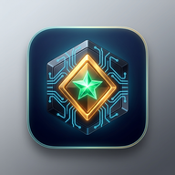
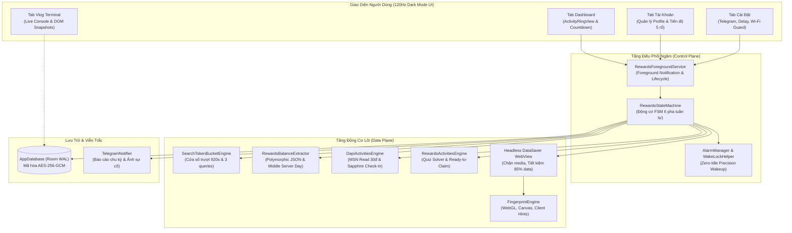

# 💎 RewardsNode — Autonomous Microsoft Rewards Engine for Android

<p align="center">
  
</p>

<p align="center">
  <b>Trạm Điều Phối Tự Động Hóa Microsoft Bing Rewards Độc Lập Toàn Diện Trên Nền Tảng Android</b><br>
  <i>100% Pure Android SDK • Không Thư Viện Ngoài • Máy Trạng Thái FSM 6 Pha • Cửa Sổ Trượt Token Bucket • Viễn Trắc Telegram 3 Tầng</i>
</p>

<p align="center">
  
  
  
  
  
  
  
</p>

---

## 🌟 Giới Thiệu Dự Án (Project Overview)

**RewardsNode v2.0.0** là giải pháp phần mềm Android độc lập cấp doanh nghiệp, biến chiếc điện thoại của bạn thành một "Autonomous Worker Node" vận hành 24/7. Ứng dụng tự động hóa hoàn chỉnh toàn bộ chu kỳ thu hoạch điểm thưởng trong hệ sinh thái **Microsoft Bing Rewards** với độ ổn định, tính tàng hình và hiệu suất tối đa.

Được xây dựng trên triết lý **Zero-Trust Security & Minimalist Architecture (YAGNI)**, ứng dụng **hoàn toàn không dùng thư viện ngoài**, không yêu cầu quyền Root, kiểm soát nghiêm ngặt từng mili-giây CPU WakeLock để chống hao pin, và ứng dụng thuật toán máy trạng thái đóng vòng (Closed-Loop FSM) để vượt qua mọi rào cản kiểm duyệt khắt khe nhất của Microsoft.

> 📖 **Đọc thêm tài liệu kỹ thuật chuyên sâu:**
> - [🏛️ Kiến Trúc Hệ Thống & Đặc Tả Kỹ Thuật (ARCHITECTURE.md)](./docs/ARCHITECTURE.md)
> - [📚 Mục Lục Điều Hướng Tài Liệu (SUMMARY.md)](./docs/SUMMARY.md)

---

## 🚀 5 Nhóm Tính Năng Đột Phá Thế Hệ v2.0.0

### 1. 🔄 Hỗ Trợ Đầy Đủ 5 Rổ Điểm & Động Cơ Dual DAPI
- **🖥️ PC Search (90 – 150 pts):** Giả lập trình duyệt Microsoft Edge Desktop Windows NT 10.0 chuẩn xác với form code `&form=QBLH`.
- **📱 Mobile Search (60 – 100 pts):** Giả lập Microsoft Edge Mobile Android (`EdgA/128.0.0.0`), tích hợp bộ tiêu đề Client Hints chuẩn (`sec-ch-ua-mobile: ?1`) và form code `&form=STARTR&PC=EMMX01`.
- **🌐 Edge Bonus (12 – 20 pts):** Tự động nhận diện rổ điểm độc quyền từ trình duyệt Microsoft Edge (`&form=MA13FW&pc=EUPH`).
- **📰 Đọc Báo MSN Siêu Tốc (30 pts - Read to Earn):** Tích hợp động cơ Direct DAPI Client (`dapi/me/activities`), hoàn thành 10 bài báo trong 2.5 giây mà không cần mở WebView hay cài đặt ứng dụng Bing/Start.
- **📅 Bing App Sapphire Daily Check-in:** Tự động duy trì chuỗi điểm danh 7 ngày trên Bing App qua kênh DAPI độc lập.
- **🎯 Daily Set & Punchcards Auto-Solver:** Tự động giải đố thông minh (Quiz, Poll, This or That, Supersonic Quiz), cào toàn bộ thẻ ưu đãi bổ sung (`morePromotions`).
- **🎁 Nhận Điểm Chờ 2 Nhấp (Ready-to-Claim):** Tự động phát hiện và nhận điểm thưởng tích lũy qua cửa sổ `?modal=pointsclaim`.

### 2. ⚙️ Máy Trạng Thái FSM 6 Pha Tuần Tự & Closed-Loop Delta Tracking
- **6 Pha Tuần Tự Khép Kín:**
  - `Pha 0`: Pre-Search Activities (Ready-to-Claim 2 nhấp, Daily Set Quiz/Poll, More Promotions).
  - `Pha 0.5`: DAPI Mobile Activities (Sapphire Check-in & MSN Read to Earn 30đ).
  - `Pha 1`: PC Search (Desktop Edge qua Token Bucket).
  - `Pha 2`: Mobile Search (Mobile Edge, tự động Level Gating bỏ qua nick Level 1).
  - `Pha 3`: Edge Bonus (Desktop Edge 12đ).
  - `Pha 4`: Reconciliation Loop (Đối soát toàn diện, tính toán deficit và cày bù phẫu thuật Surgical Micro-Catchup tối đa 2 lần).
- **Skip-Logic Thông Minh:** Nếu một rổ điểm đã đạt tối đa trong ngày, FSM tự động bỏ qua ngay lập tức để tiết kiệm thời gian và tài nguyên mạng.
- **Closed-Loop Delta Tracking:** Theo dõi biến thiên điểm số thực tế $\Delta \text{Points} = \text{Points}_{t+1} - \text{Points}_t$. Nếu điểm không tăng, lập tức dừng chuỗi để tránh rủi ro.

### 3. ⏱️ Quản Lý Hạn Ngạch Token Bucket & Giải Phóng HoL Blocking
- **SearchTokenBucketEngine Cửa Sổ Trượt 920s:** Chia nhỏ lượt tìm kiếm thành các cửa sổ an toàn 920 giây (15 phút + 20s đệm chống clock-drift), mỗi cửa sổ tối đa đúng 3 queries (9 điểm), triệt tiêu hoàn toàn nguy cơ bị Microsoft phạt Cooldown 15 phút.
- **Chống Lệch Nhịp Đồng Hồ (Clock-Drift Fix):** Tự động nhận diện hiện tượng nhảy lùi hoặc nhảy vọt thời gian của hệ điều hành để tái neo mốc thời gian an toàn.
- **Non-blocking Round-Robin Dispatcher:** Xóa bỏ triệt để hiện tượng tắc nghẽn đầu hàng (Head-of-Line / HoL Blocking). Khi một nick chạm hạn ngạch hoặc dính cooldown, hệ thống lập tức nhường slot cho nick khác, không block luồng xử lý.
- **Zero-Idle Sleep:** Tự động giải phóng 100% CPU WakeLock trong thời gian chờ Cooldown, đánh thức bằng Android `AlarmManager` chuẩn xác từng mili-giây.

### 4. 🛡️ Cơ Chế Phòng Vệ Tàng Hình & Chống Khóa Nick Đa Tầng
- **FingerprintEngine:** Giả lập sâu WebGL Renderer, Canvas Fingerprint, Audio Context, Hardware Concurrency và loại bỏ hoàn toàn header `X-Requested-With`.
- **Human-like Dwell & Trajectory:** Mô phỏng khoảng nghỉ ngẫu nhiên (`searchDelayMinSec` – `searchDelayMaxSec`), hành vi cuộn trang mượt mà trước khi kích hoạt tìm kiếm.
- **Bóc Tách JSON Đa Hình & Middle Server Day:** Bộ phân tích cú pháp thích ứng cấu trúc dữ liệu A/B Test của Microsoft và thuật toán neo ngày trung tâm `[keys.length / 2]` giải quyết triệt để lỗi lệch múi giờ toàn cầu.
- **Hệ Thống 4 Bộ Ngắt Mạch (Safety Circuit Breakers):**
  - *Captcha Interceptor:* Phát hiện Arkose Labs / Captcha, lập tức cô lập tài khoản, chụp ảnh màn hình gửi Telegram.
  - *Frozen Balance Circuit Breaker:* Phát hiện điểm bị treo dù request thành công, dừng tài khoản an toàn.
  - *Auth Desync Detection:* Tự động phát hiện khi cookie hết hạn hoặc mất đồng bộ Bing Search Auth.
  - *Network & Battery Guard:* Tạm dừng khi pin $< 15\%$ hoặc khi mất Wi-Fi (nếu cấu hình chế độ Wi-Fi Only).

### 5. 👥 Quản Lý Đa Tài Khoản Cô Lập & Viễn Trắc Telegram 3 Tầng
- **SQLite WAL Sandbox:** Lưu trữ và quản lý hàng chục tài khoản độc lập trong Room Database với chế độ Write-Ahead Logging (WAL).
- **Mã Hóa Cột AES-256-GCM:** Bảo vệ snapshot Cookie và thông tin cá nhân bằng Android Keystore an toàn tuyệt đối.
- **Chuyển Đổi Session Sạch 100%:** Dọn sạch toàn bộ Cookie, LocalStorage, IndexedDB và Cache của WebView khi đổi tài khoản, ngăn chặn nguy cơ liên kết tài khoản chéo.
- **Viễn Trắc Telegram 3 Tầng:**
  - *Tầng 1:* Tự động lọc và thoát ký tự Markdown v2 (`escapeMarkdown`) chống lỗi 400 Bad Request.
  - *Tầng 2:* Tự động phân mảnh tin nhắn dài và tự động fallback sang Plain Text nếu gửi thất bại.
  - *Tầng 3:* Chụp và gửi ảnh màn hình WebView qua Multipart Upload khi xảy ra sự cố nghiêm trọng.

---

## 🏗️ Kiến Trúc Hệ Thống (System Architecture)



---

## 🛠️ Hướng Dẫn Khởi Động Nhanh Trong 3 Phút (Quick Start)

### Bước 1: Cài Đặt Ứng Dụng
- Tải file `RewardsNode.apk` bản mới nhất từ mục Releases hoặc lấy từ thư mục build.
- Cài đặt lên điện thoại Android (yêu cầu Android 8.0 trở lên, API 26 – 34).
- Cấp quyền thông báo (Notification) để ứng dụng duy trì Foreground Service ổn định.

### Bước 2: Cấu Hình Viễn Trắc Telegram (Khuyến Nghị)
1. Chat với [@BotFather](https://t.me/BotFather) để tạo một bot mới và sao chép **Bot Token** (ví dụ: `7123456789:AAH...`).
2. Chat với [@userinfobot](https://t.me/userinfobot) để lấy **Chat ID** của bạn (ví dụ: `123456789`).
3. Mở tab **Cài Đặt** trong RewardsNode:
   - Dán Bot Token và Chat ID.
   - Nhấn **"Gửi tin thử"** để kiểm tra kết nối thông suốt.
   - Nhấn **"Lưu Cấu Hình Cài Đặt"**.

### Bước 3: Đăng Nhập Tài Khoản Microsoft
1. Chuyển sang tab **Tài Khoản** $\rightarrow$ Nhấn nút `+` (Thêm Tài Khoản).
2. Hộp thoại WebView bảo mật mở ra: Đăng nhập tài khoản Microsoft Outlook/Hotmail của bạn.
3. Sau khi trang đăng nhập chuyển hướng thành công về Bing/Live, hệ thống tự động bóc tách và mã hóa Cookie lưu vào cơ sở dữ liệu.
4. Lặp lại với các tài khoản khác (nếu có nhiều nick).

### Bước 4: Khởi Động Trạm Node
1. Chuyển sang tab **Dashboard** $\rightarrow$ Nhấn **"Khởi Động Node"**.
2. Thiết bị sẽ tự động thực thi chu trình:
   - Chạy tuần tự qua các Pha 0, Pha 0.5, Pha 1, Pha 2, Pha 3 và Pha 4.
   - Khi gặp hạn ngạch Token Bucket, tự động luân chuyển sang nick kế tiếp (Non-blocking Round-Robin).
   - Tự động gửi báo cáo tổng kết chi tiết về Telegram khi hoàn tất tất cả tài khoản trong ngày.
   - Bạn có thể chuyển sang tab **Vlog** để theo dõi trực tiếp từng dòng lệnh của terminal.

---

## 📋 Bảng Tra Cứu Mã Nhật Ký & Sự Cố (Vlog Tags Reference)

Khi mở tab **Vlog Console**, bạn sẽ nhìn thấy các thẻ gắn đầu dòng (Tags). Dưới đây là bảng giải nghĩa chi tiết:

| Mã Tag | Ý Nghĩa Kỹ Thuật | Hành Vi Tự Phục Hồi Của Hệ Thống |
| :--- | :--- | :--- |
| `[STARTUP-CLAIM]` | Kiểm tra điểm thưởng chờ nhận khi khởi động phiên | Kích hoạt modal nhận điểm thưởng ngay lập tức. |
| `[READY-TO-CLAIM]` | Phát hiện điểm thưởng chờ nhận trong Pha 0 | Mở hộp thoại `?modal=pointsclaim`, thực hiện quy trình 2 nhấp nhận điểm. |
| `[SKIP-PC]` | Rổ PC Search đã đạt tối đa (`pcProgress >= pcMax`) | Bỏ qua Pha 1, chuyển thẳng sang Pha 2 (Mobile Search). |
| `[SKIP-MOB]` | Rổ Mobile đã đạt tối đa hoặc tài khoản đang ở **Level 1** | Bỏ qua Pha 2, chuyển thẳng sang Pha 3 (Edge Bonus). |
| `[SKIP-EDGE]` | Rổ Edge Bonus đã hoàn tất 12/12 điểm | Bỏ qua Pha 3, chuyển sang Pha 4 (Reconciliation Loop). |
| `[SKIP-ACT]` | Đã hoàn tất toàn bộ Daily Set và ưu đãi bổ sung | Bỏ qua Pha 0, không tải lại trang Daily Set thừa thãi. |
| `[SKIP-DAPI]` | Đã đủ 30/30đ Đọc báo và hoàn thành Điểm danh Bing App | Bỏ qua Pha 0.5, chuyển ngay sang tìm kiếm. |
| `[SKIP-EXPIRED]` | Snapshot Cookie bị trống hoặc đã hết hạn | Đánh dấu `cookieExpired = true`, cách ly an toàn 15 phút, bỏ qua không cày nick lỗi. |
| `[TOKEN-COOLDOWN]` | Chạm trần 3 queries trong cửa sổ trượt 920s | Khóa slot tài khoản hiện tại, chuyển ngay sang nick khác (Non-blocking Round-Robin). |
| `[COOLDOWN-15M]` | Phát hiện $\Delta \text{Points} == 0$ liên tiếp (Cờ Cooldown Microsoft) | Dời lịch tài khoản sang 15 phút sau, giải phóng WakeLock để tiết kiệm pin. |
| `[RECONCILIATION]` | Kích hoạt vòng lặp đối soát thâm hụt điểm sau tìm kiếm | Quét thâm hụt và thực hiện cày bù phẫu thuật (Surgical Micro-Catchup) tối đa 2 lần. |
| `[AUTH-DESYNC]` | Mất đồng bộ danh tính Bing Search (`isRewardsUser == false`) | Tạm ngưng tìm kiếm trên nick này để bảo vệ điểm và tránh khóa nick. |
| `[CAPTCHA]` | Phát hiện iframe thử thách bot Arkose Labs / Captcha | Lập tức dừng cày, chụp ảnh màn hình WebView gửi về Telegram cảnh báo khẩn. |
| `[NET-GUARD]` | Mất kết nối Wi-Fi khi bật chế độ "Chỉ chạy trên Wi-Fi" | Tạm dừng toàn bộ hoạt động, đặt lịch kiểm tra lại sau mỗi 60 giây. |
| `[BATTERY-GUARD]` | Pin thiết bị $< 15\%$ và chưa cắm sạc | Tạm hoãn chu kỳ, bảo vệ tuổi thọ pin thiết bị. |

---

## 💻 Hướng Dẫn Biên Dịch Mã Nguồn (Build from Source)

### Yêu Cầu Môi Trường:
- **Hệ điều hành:** Windows 10/11, macOS, hoặc Linux
- **JDK:** OpenJDK 17 hoặc Eclipse Temurin 21 (đã cấu hình `JAVA_HOME`)
- **Android SDK:** Build-Tools `34.0.0+` hoặc `36.1.0` (đã cấu hình `ANDROID_HOME`)
- **Gradle:** Phiên bản 8.11+ (hoặc sử dụng wrapper `gradlew` đính kèm)

### Các Lệnh Biên Dịch Nhanh:

```bash
# 1. Clone kho lưu trữ mã nguồn
git clone https://github.com/vanlinh0392-art/RewardsNode.git
cd RewardsNode

# 2. Chạy toàn bộ Unit Tests kiểm thử máy trạng thái và token bucket
./gradlew testDebugUnitTest

# 3. Biên dịch gói cài đặt APK Debug chuẩn
./gradlew assembleDebug

# 4. (Tùy chọn) Biên dịch qua Script tự động hóa độc lập của dự án
# Dành cho Windows PowerShell:
.\build_apk.ps1

# Dành cho Linux / macOS Bash:
chmod +x build_apk.sh
./build_apk.sh
```

File APK sau khi hoàn tất sẽ nằm tại:
`app/build/outputs/apk/debug/app-debug.apk` (hoặc `RewardsNode.apk` tại thư mục gốc).

---

## 🔒 Cam Kết Bảo Mật (Zero-Trust Privacy Standard)

- **100% Giao Tiếp Trực Tiếp:** Không sử dụng bất kỳ máy chủ trung gian (Middle Server) nào. Toàn bộ lưu lượng mạng được gửi mã hóa trực tiếp giữa thiết bị của bạn và các cụm máy chủ chính thức của Microsoft (`login.live.com`, `rewards.bing.com`, `www.bing.com`).
- **Mã Hóa Cục Bộ Tiêu Chuẩn Quân Đội:** Cookie và dữ liệu định danh tài khoản được mã hóa bằng thuật toán `AES-256-GCM` với Master Key lưu trữ an toàn trong vùng nhớ phần cứng Android Keystore.
- **Không Rò Rỉ Bí Mật (No Hardcoded Secrets):** Mã nguồn công khai hoàn toàn sạch, không chứa bất kỳ Token Bot, Chat ID hay thông tin người dùng nào.
- **Chế Độ Hủy Dấu Vết (Forensic Shredder):** Hỗ trợ tính năng dọn sạch toàn bộ cơ sở dữ liệu và phiên làm việc chỉ bằng một chạm khẩn cấp.

---

## 📄 Bản Quyền & Tuyên Bố Miễn Trừ Trách Nhiệm (Disclaimer)

Dự án này được phát triển hoàn toàn vì mục đích **nghiên cứu kiến trúc lập trình hệ thống Android Native, phân tích giao thức mạng và tự động hóa quy trình**. Tác giả không khuyến khích và không chịu bất kỳ trách nhiệm pháp lý nào đối với các hành vi lạm dụng vi phạm Điều khoản dịch vụ của bên thứ ba.

Phát hành mã nguồn mở theo giấy phép **[MIT License](LICENSE)**.
