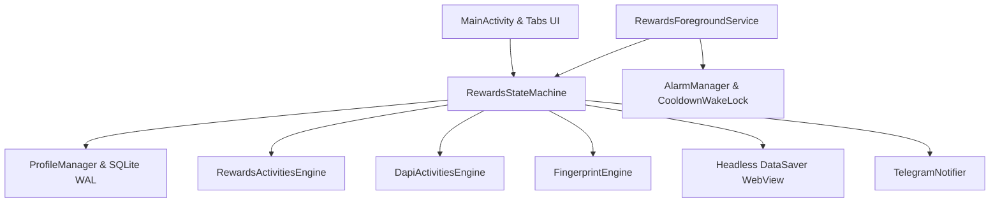

# 💎 RewardsNode — Autonomous Microsoft Rewards Engine for Android

<p align="center">
  
</p>

<p align="center">
  <b>Trạm Điều Phối Tự Động Hóa Microsoft Bing Rewards Toàn Diện Trên Nền Tảng Android</b><br>
  <i>100% Android Native SDK • Không Thư Viện Ngoài • Cô Lập Phiên Đa Tài Khoản • Cảnh Báo Telegram Tức Thời</i>
</p>

<p align="center">
  
  
  
  
  
</p>

---

## 🌟 Giới Thiệu Dự Án (Project Overview)

**RewardsNode** là ứng dụng Android độc lập, thông minh và tối ưu hóa cao, biến thiết bị di động thành một "Worker Node" tự động hóa hoàn toàn chu kỳ tích điểm hàng ngày của hệ sinh thái **Microsoft Bing Rewards**.

Ứng dụng được thiết kế theo tư duy **Zero-Trust Security & Minimalist Architecture (YAGNI)**: hoạt động bền bỉ 24/7 dưới dạng Foreground Service có WakeLock kiểm soát, tự động vượt qua mọi rào cản kiểm duyệt mà không làm hao pin, nóng máy hay yêu cầu quyền Root.

---

## 🚀 Tính Năng Đột Phá (Key Features v1.5.0)

### 1. 🔄 Hỗ Trợ Đầy Đủ Tất Cả Các Rổ Điểm (Full Rewards Spectrum)
- **🖥️ PC Search (90 pts):** Giả lập chính xác trình duyệt Desktop Microsoft Edge với User-Agent chuẩn và form code `&form=QBLH`.
- **📱 Mobile Search (60 pts):** Giả lập Edge Mobile (`EdgA/128.0.0.0`), hỗ trợ Client Hints chuẩn (`sec-ch-ua-mobile: ?1`) và form code `&form=STARTR&PC=EMMX01`.
- **🌐 Edge Bonus (12 pts):** Tự động nhận diện và cày trọn vẹn điểm thưởng độc quyền từ trình duyệt Microsoft Edge (`&form=MA13FW&pc=EUPH`).
- **📰 Đọc Báo Bing App (30 pts - Bing App Read News):** Tích hợp động cơ Dual DAPI (`type=103` & `type=101`), tự động đọc 10 bài báo ngầm mà không cần cài đặt hay mở app Bing chính thức.
- **📅 Check-in Bing App Hàng Ngày:** Tự động hoàn thành điểm danh chuỗi (Daily Check-in Streak) qua DAPI Bridge độc lập.
- **🎯 Daily Set & Punchcards:** Tự động giải câu đố (Quiz), bình chọn (Poll), tìm kiếm chủ đề và thu hoạch các thẻ hoạt động bổ sung (More Activities, Promotional Cards).

### 2. 🛡️ Cơ Chế Tàng Hình & Chống Khóa Nick (Stealth & Anti-Ban Architecture)
- **Fingerprint Camouflage:** Tự động loại bỏ header `X-Requested-With`, đồng bộ hóa WebGL/Canvas và User-Agent giữa các phiên.
- **Human-like Dwell & Trajectory:** Khoảng nghỉ tìm kiếm ngẫu nhiên (`3s - 7s`), mô phỏng hành vi cuộn chuột và đọc trang tự nhiên của con người.
- **Arkose Labs & Captcha Detection:** Tự động nhận diện thử thách bot / Cloudflare trong DOM, lập tức dừng tài khoản để bảo toàn điểm và chụp ảnh màn hình gửi về Telegram.
- **Frozen Balance Circuit Breaker:** Tự động phát hiện khi tài khoản bị treo số dư (điểm không tăng dù tìm kiếm thành công $N$ lượt liên tiếp), lập tức cách ly an toàn.

### 3. 👥 Quản Lý Đa Tài Khoản Cô Lập Tuyệt Đối (Multi-Account Isolation)
- **SQLite WAL Sandbox:** Lưu trữ và mã hóa Cookie riêng biệt cho từng tài khoản; chuyển đổi profile sạch sẽ 100%, không bao giờ lẫn lộn session.
- **Per-Profile Control:** Bật/tắt chạy riêng lẻ từng nick, đặt lịch trình và theo dõi tiến độ chi tiết từng rổ điểm.
- **1-Tap Emergency Reset:** Khôi phục khẩn cấp và dọn dẹp cache/proxy WebView tức thì chỉ bằng một chạm.

### 4. 📢 Tích Hợp Telegram Bot Thông Minh (Smart Telegram Telemetry)
- **Báo Cáo Chu Kỳ Hoàn Thành:** Tự động gửi bảng điểm tổng hợp chi tiết tất cả tài khoản về Telegram khi hoàn tất trong ngày.
- **Cơ Chế Phòng Vệ 3 Tầng:** Tự động thoát ký tự đặc biệt (`escapeMarkdown`) chống lỗi HTTP 400 Bad Request, tự động fallback sang Plain Text và phân mảnh tin nhắn an toàn.
- **Chụp Màn Hình Cảnh Báo:** Tự động chụp lại giao diện WebView tại thời điểm xảy ra Captcha hoặc lỗi đăng nhập và gửi thẳng về máy người dùng.

### 5. 📱 Giao Diện OLED Dark Mode Đẳng Cấp
- **Dashboard:** Vòng tròn tiến độ 3 màu (`ActivityRingView`), đồng hồ đếm ngược reset ngày mới 00:00:00, điều khiển Start/Stop Node tức thì.
- **Accounts:** Danh sách thẻ tài khoản trực quan, hiển thị tiến độ 4 rổ điểm, chuỗi ngày streak và số dư khả dụng.
- **Vlog Console:** Terminal trực tiếp ghi nhận từng hành động (SEARCH, CLAIM, CAPTCHA, ALARM, SYSTEM), hỗ trợ xem DOM Snapshot.
- **Settings:** Thiết kế tiện lợi với thanh nút Lưu hạ sát đáy tự nhiên, cụm nút điền mẫu Bot Telegram 1-chạm.

---

## 🏗️ Kiến Trúc Hệ Thống (System Architecture)



---

## 🛠️ Hướng Dẫn Cài Đặt & Sử Dụng (Quick Start)

### 1. Tải và Cài Đặt Bản Dựng Sẵn (Pre-built APK)
- Tải file `app-debug.apk` mới nhất từ tab Releases hoặc từ kênh phân phối.
- Cài đặt lên điện thoại Android (yêu cầu Android 8.0 trở lên).

### 2. Cấu Hình Telegram Bot (Tùy Chọn)
1. Chat với [@BotFather](https://t.me/BotFather) để tạo bot mới và nhận **Bot Token** (ví dụ: `123456789:ABC...`).
2. Chat với [@userinfobot](https://t.me/userinfobot) để lấy **Chat ID** của bạn.
3. Mở tab **Cài Đặt** trong ứng dụng RewardsNode:
   - Dán **Bot Token** và **Chat ID** vào ô tương ứng.
   - Nhấn **"Gửi tin thử"** để kiểm tra kết nối.
   - Nhấn **"Lưu Cấu Hình Cài Đặt"**.

### 3. Thêm Tài Khoản & Bắt Đầu
1. Vào tab **Tài Khoản** $\rightarrow$ Nhấn biểu tượng dấu `+`.
2. Đăng nhập tài khoản Microsoft Outlook/Hotmail của bạn trong WebView bảo mật.
3. Quay lại tab **Dashboard** $\rightarrow$ Nhấn **"Khởi Động Node"**.
4. Ứng dụng sẽ tự động chạy ngầm, vượt qua các khoảng thời gian nghỉ Cooldown và tự tắt an toàn khi hoàn thành chỉ tiêu.

---

## 💻 Hướng Dẫn Biên Dịch Mã Nguồn (Build from Source)

### Yêu Cầu Môi Trường:
- JDK 17 hoặc JDK 21
- Android SDK Build-Tools 34.0.0+
- Gradle 8.11+ (hoặc dùng `gradlew` tích hợp sẵn)

```bash
# Clone repository
git clone https://github.com/vanlinh0392-art/RewardsNode.git
cd RewardsNode

# Chạy Unit Test kiểm thử logic lõi
./gradlew testDebugUnitTest

# Biên dịch gói APK Debug
./gradlew assembleDebug

# File APK xuất xưởng tại:
# app/build/outputs/apk/debug/app-debug.apk
```

---

## 🔒 Cam Kết Bảo Mật (Zero-Trust Privacy)

- **Không Máy Chủ Trung Gian:** Toàn bộ lưu lượng mạng được gửi trực tiếp giữa thiết bị của bạn và máy chủ Microsoft (`login.live.com`, `rewards.bing.com`).
- **Không Hardcode Bí Mật:** Ứng dụng không chứa bất kỳ Token, mật khẩu hay Chat ID nào trong mã nguồn công khai.
- **Mã Hóa Cục Bộ:** Cookie và thông tin định danh được lưu trữ an toàn trong vùng nhớ riêng tư của ứng dụng (`/data/data/com.agy.rewardsnode/`).

---

## 📄 Bản Quyền & Tuyên Bố Từ Chối Trách Nhiệm (Disclaimer)

Dự án này được phát triển phục vụ mục đích **nghiên cứu, học tập kiến trúc lập trình Android Native và tự động hóa hệ thống**. Tác giả không chịu trách nhiệm đối với bất kỳ hành vi lạm dụng nào vi phạm điều khoản dịch vụ của bên thứ ba.

Phát hành theo giấy phép **MIT License**.
