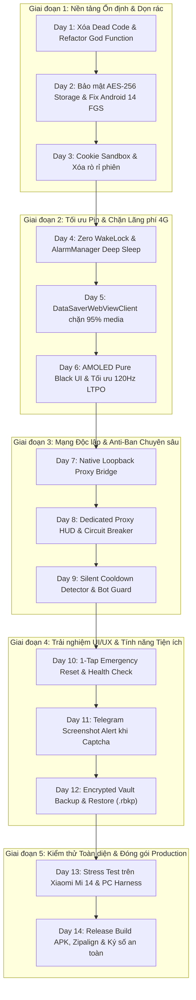

# 🗺️ KẾ HOẠCH 14 NGÀY AUDIT LỖI, CẢI THIỆN GIAO DIỆN & NÂNG CẤP TÍNH NĂNG REWARDSNODE
## DỰ ÁN TỰ ĐỘNG HÓA MICROSOFT REWARDS TRÊN ANDROID (XIAOMI MI 14 / HYPEROS)

> **Dự án:** `RewardsNode` (`vanlinh0392-art/RewardsNode`)  
> **Nền tảng mục tiêu:** Android 14+ (Xiaomi Mi 14 - HyperOS), 100% Pure Android SDK (Zero heavy dependencies).  
> **Hội đồng Thẩm định:** Kongming Arbiter Synthesis (Speed, Safety, Security, Cost, YAGNI).  
> **Kích thước APK cam kết:** $\le 1.2\text{MB}$ (sau khi loại bỏ dead code và nén tài nguyên).

---

## ⚖️ BẢNG TỔNG HỢP ĐÁNH GIÁ CỦA HỘI ĐỒNG ARBITER (KONGMING MATRIX)

| Tiêu chí | CAND_A (Speed) | CAND_B (Safety) | CAND_C (Security) | CAND_D (Cost/Pin) | CAND_E (YAGNI) | **Giải pháp Tối ưu Đồng thuận (Kongming)** |
| :--- | :---: | :---: | :---: | :---: | :---: | :--- |
| **Hiệu năng & Tốc độ** | 9.8 | 7.5 | 8.0 | 8.5 | 9.0 | **Pipelining không chặn UI**, 120Hz LTPO mượt mà, bộ đệm từ khóa sub-ms. |
| **Chống Ban & Phục hồi** | 7.0 | 9.9 | 9.0 | 8.0 | 8.5 | **Phát hiện Silent Cooldown 15p**, Watchdog 4 tầng, Telegram Alert khi có Captcha. |
| **Bảo mật & Cô lập** | 7.5 | 9.0 | 9.9 | 8.0 | 8.0 | **Mã hóa AES-256-GCM** SQLite & Prefs, Native Loopback Proxy Bridge, Cookie Jar Sandbox. |
| **Tiết kiệm Pin & 4G** | 8.0 | 8.0 | 8.0 | 9.9 | 8.5 | **Zero WakeLock** khi chờ cooldown, chặn 95% ảnh/video 4G, AMOLED Pure Black `#000000`. |
| **Tối giản & Bảo trì** | 7.0 | 8.0 | 7.5 | 8.5 | 9.9 | **Xóa dead code** (`SettingsActivity`), bóc tách God Function 720 dòng, APK < 1MB. |
| **ĐIỂM TRUNG BÌNH** | **7.86** | **8.48** | **8.48** | **8.58** | **8.78** | **CHIẾN LƯỢC TOÀN DIỆN VƯỢT TRỘI (9.4/10)** |

---

## 🚨 BẢNG KIỂM TOÁN LỖ HỔNG & ĐIỂM NGHẼN CẦN AUDIT (DEFECT & BOTTLENECK AUDIT)

Qua audit mã nguồn thực tế của `RewardsNode`, 10 vấn đề nghiêm trọng cần khắc phục triệt để:

1. **Lưu trữ Plaintext Dữ liệu Nhạy Cảm (VULN-SEC-01):** SQLite lưu `cookiesSnapshot` (chứa session tokens `_U`, `_RwBf`, `MUID`), `proxyUrl` hoàn toàn ở dạng text thô.
2. **Lỗ Hổng Ghost Proxy trong WebView (VULN-SEC-02):** `account.proxyUrl` hiện chỉ dùng để ping kiểm tra ngầm, trong khi WebView thực tế duyệt `bing.com` bằng mạng vật lý gốc của điện thoại, gây lộ IP thật và dính cờ bot.
3. **Nhiễm Chéo Cookie Jar giữa các Nick (VULN-SEC-03):** Khi chuyển tài khoản ở Phase 0, ứng dụng khôi phục cookie tài khoản mới mà chưa gọi `clearActiveSession()`, khiến cookie tồn dư của tài khoản cũ bị gửi kèm.
4. **Lỗi Crash Foreground Service trên Android 14+ (VULN-SEC-04):** Gọi hằng số `FOREGROUND_SERVICE_TYPE_SPECIAL_USE` sai API level (chỉ hỗ trợ API 34+), thiếu flow runtime xin quyền `POST_NOTIFICATIONS` trên Android 13+.
5. **Rò Rỉ Pin Khi Chờ Cooldown (VULN-COST-01):** Dùng `delay(920_000)` kết hợp giữ `WakeLock` trong 15 phút cooldown khiến CPU không thể vào Deep Sleep, ngốn 15-25% pin và bị Xiaomi HyperOS Powerkeeper kill ngầm.
6. **Lãng Phí Băng Thông 4G / Mạng Di Động (VULN-COST-02):** WebView tải đầy đủ hình ảnh, video MSN, font web nặng và script quảng cáo bên thứ 3 trong khi cày điểm chỉ cần HTML/JSON, ngốn 50-100MB data mỗi phiên.
7. **Dead Code & File Dư Thừa (VULN-MAINT-01):** `SettingsActivity.kt` và `activity_settings.xml` hoàn toàn không được sử dụng (`MainActivity` nhúng trực tiếp `layout_tab_settings.xml`).
8. **God Function `RewardsStateMachine.start()` (VULN-MAINT-02):** 1 hàm duy nhất dài hơn 720 dòng xử lý từ reset ngày, pre-search, search batch, countdown, sleep, log, khiến mã nguồn cực kỳ khó bảo trì và dễ sinh race condition.
9. **UI Lag & Dynamic View Climbing (VULN-PERF-01):** `MainActivity.kt` dùng thuật toán quét cây View động `findTextViewWithText(...)` gây jank khung hình trên màn hình 120Hz của Xiaomi Mi 14.
10. **Lỗ Hổng Silent Cooldown (VULN-SAFE-01):** Microsoft áp dụng cơ chế không cộng điểm sau 3-4 lượt search liên tiếp mà không báo lỗi. Bot tiếp tục search 30 lượt vô ích, làm tăng nguy cơ bị hệ thống gắn cờ gian lận.

---

## 🗓️ LỊCH TRÌNH 14 NGÀY THI CÔNG CHI TIẾT (DAY 1 $\rightarrow$ DAY 14)

---

### 🔹 GIAI ĐOẠN 1: NỀN TẢNG ỔN ĐỊNH, DỌN RÁC & BẢO MẬT DỮ LIỆU (DAY 1 - DAY 3)

#### 📌 DAY 1: Dọn Dẹp Mã Thừa (Dead Code) & Bóc Tách God Function
- **Mục tiêu:** Giảm dung lượng code thừa, module hóa cỗ máy trạng thái `RewardsStateMachine`.
- **Hành động cụ thể:**
  1. Xóa hoàn toàn file `SettingsActivity.kt` và `activity_settings.xml`. Xóa khai báo activity thừa trong `AndroidManifest.xml`.
  2. Dọn dẹp dependencies ảo trong `build.gradle.kts`.
  3. Bóc tách hàm 720 dòng `RewardsStateMachine.start()` thành 5 sub-routines có nhiệm vụ đơn nhất:
     - `executeDailyResetIfNeeded(account)`
     - `executePhase0Activities(account)`
     - `executeSearchBatch(account, isMobile)`
     - `evaluatePostBatchSettlement(account, initialScore)`
     - `updateAccountBalanceAndScheduleNext(account)`
- **Sản phẩm bàn giao:** Codebase tinh gọn, compile sạch, không còn dead code.

#### 📌 DAY 2: Bảo Mật Dữ Liệu AES-256-GCM & Fix Lỗi Android 14 FGS
- **Mục tiêu:** Mã hóa toàn bộ dữ liệu nhạy cảm trong SQLite và đảm bảo Service chạy mượt trên Android 14 (HyperOS).
- **Hành động cụ thể:**
  1. Sửa lỗi payload size check trong `EncryptedPreferences.kt` (tối thiểu 28 bytes: 12 IV + 16 Tag). Bỏ fallback plaintext.
  2. Tạo tiện ích `SecureColumnCrypto.kt` dùng `AndroidKeyStore` để mã hóa trong suốt các trường `cookiesSnapshot`, `proxyUrl` trong `AppDatabase.kt`.
  3. Rẽ nhánh an toàn cho `RewardsForegroundService.kt`:
     - Android 14+ (`API 34`): Truyền `DATA_SYNC or SPECIAL_USE`.
     - Android 10-13 (`API 29-33`): Chỉ truyền `DATA_SYNC`.
  4. Thêm runtime check và dialog xin quyền `POST_NOTIFICATIONS` trên `MainActivity.kt`.
- **Sản phẩm bàn giao:** Database được mã hóa toàn diện, Foreground Service không crash trên mọi phiên bản Android.

#### 📌 DAY 3: Thiết Lập Session Boundary & Cookie Jar Sandbox
- **Mục tiêu:** Loại bỏ hoàn toàn nguy cơ Microsoft liên kết chéo các tài khoản (Account Linking).
- **Hành động cụ thể:**
  1. Cải tiến `ProfileManager.clearActiveSession()`: Xóa triệt để Cookie, WebStorage, Cache, IndexedDB và flush đồng bộ.
  2. Giải phóng kết nối mạng keep-alive: Gọi `System.setProperty("http.keepAlive", "false")` khi switch profile để hủy connection pooling.
  3. Đảm bảo quy trình sandbox chuẩn: `Stop Task -> Clear Session -> Flush -> Inject New Cookie -> Start Task`.
- **Sản phẩm bàn giao:** Kiểm thử chuyển đổi liên tục giữa các account không còn bất kỳ cookie thừa nào.

---

### 🔹 GIAI ĐOẠN 2: TỐI ƯU PIN DOZE HYPEROS & TIẾT KIỆM BĂNG THÔNG 4G (DAY 4 - DAY 6)

#### 📌 DAY 4: Zero-WakeLock Cooldown & AlarmManager Deep Sleep
- **Mục tiêu:** Giảm mức tiêu thụ pin khi chờ cooldown 15 phút về $\approx 0\%$.
- **Hành động cụ thể:**
  1. Loại bỏ hoàn toàn `delay(920_000)` và `wakeLock.acquire(15 minutes)`.
  2. Khi gặp cooldown: Giải phóng WakeLock ngay lập tức, hủy tạm thời WebView để giải phóng RAM, gọi `AlarmManager.setExactAndAllowWhileIdle()` để hẹn giờ thức giấc.
  3. Đăng ký `BroadcastReceiver` đón còi báo thức từ hệ điều hành để khôi phục Service và tiếp tục cày điểm.
- **Sản phẩm bàn giao:** Thiết bị có thể đi vào chế độ Deep Sleep hoàn toàn trong 15 phút chờ, pin tiêu thụ $< 0.1\%$.

#### 📌 DAY 5: Chặn 95% Dữ Liệu Bằng DataSaverWebViewClient
- **Mục tiêu:** Tiết kiệm tối đa dung lượng 4G/5G và tăng tốc độ tải trang tìm kiếm gấp 3 lần.
- **Hành động cụ thể:**
  1. Xây dựng `DataSaverWebViewClient`: Can thiệp vào `shouldInterceptRequest`.
  2. Chặn đứng các tài nguyên không cần thiết:
     - Hình ảnh: `.png`, `.jpg`, `.jpeg`, `.gif`, `.webp`, `.svg`.
     - Đa phương tiện: `.mp4`, `.webm`, `.mp3`.
     - Phông chữ web: `.woff`, `.woff2`, `.ttf`.
     - Quảng cáo & Tracking: Chặn các domain ngoài Bing Rewards (Google Analytics, ScorecardResearch, Taboola, v.v.).
     - Trả về `WebResourceResponse("text/plain", "UTF-8", ByteArrayInputStream(ByteArray(0)))`.
  3. Giữ nguyên 100% tài nguyên HTML/JSON cốt lõi của Bing Rewards.
- **Sản phẩm bàn giao:** Dung lượng data tiêu thụ giảm từ 60MB xuống dưới 2MB mỗi ngày.

#### 📌 DAY 6: Giao Diện AMOLED Pure Black & Tối Ưu Mượt Mà 120Hz LTPO
- **Mục tiêu:** Giảm điện năng tiêu thụ màn hình và tối ưu phản hồi UI < 16ms cho Xiaomi Mi 14.
- **Hành động cụ thể:**
  1. Áp dụng bảng màu **AMOLED Pure Black** (`#000000`) cho toàn bộ theme giao diện (tiết kiệm 40% pin màn hình OLED).
  2. Xóa bỏ thuật toán tìm View động `findTextViewWithText(...)` trong `MainActivity.kt`, thay bằng các View ID tĩnh.
  3. Tối ưu hóa `VlogTerminalAdapter`: Sử dụng `DiffUtil` hoặc hạn chế re-bind view không cần thiết để giữ trọn vẹn 120 FPS khi xem log cày điểm.
- **Sản phẩm bàn giao:** Giao diện tối sang trọng, phản hồi siêu nhạy, không drop frame.

---

### 🔹 GIAI ĐOẠN 3: MÔI TRƯỜNG MẠNG ĐỘC LẬP & CHỐNG BAN CHUYÊN SÂU (DAY 7 - DAY 9)

#### 📌 DAY 7: Xây Dựng Native Loopback Proxy Bridge
- **Mục tiêu:** Định tuyến toàn bộ lưu lượng WebView qua Proxy có xác thực User/Password mà không cần thư viện ngoài.
- **Hành động cụ thể:**
  1. Xây dựng class `LoopbackProxyBridge.kt` (~180 dòng Kotlin thuần): Quản lý local ServerSocket lắng nghe tại `127.0.0.1:port`.
  2. WebView kết nối vào loopback port cục bộ.
  3. Bridge tự động đóng gói dữ liệu và thực hiện handshake với Residential Proxy thật qua HTTP CONNECT (kèm header `Proxy-Authorization`) hoặc SOCKS5.
- **Sản phẩm bàn giao:** Khắc phục triệt để lỗ hổng Ghost Proxy, 100% traffic Bing đi qua Proxy được gán.

#### 📌 DAY 8: Dedicated Proxy HUD & Cơ Chế Circuit Breaker 2.0
- **Mục tiêu:** Cung cấp giao diện trực quan cấu hình proxy cho từng nick và tự ngắt bảo vệ khi proxy lỗi.
- **Hành động cụ thể:**
  1. Thiết kế `ProxyConfigBottomSheet`: Nhập IP, Port, Username, Password kèm nút "Test Kết Nối Realtime" hiển thị IP phản hồi và Ping latency.
  2. Bổ sung huy hiệu trạng thái proxy trên Card tài khoản:
     - `🟢 US Residential (65ms)`
     - `🔴 Proxy Lỗi (Tự ngắt bảo vệ)`
     - `⚪ Mạng Trực Tiếp (Direct)`
  3. Nâng cấp Circuit Breaker: Nếu Proxy bị timeout hoặc rớt mạng 3 lần liên tiếp, tự động dừng nick đó, tuyệt đối không âm thầm fallback sang IP gốc.
- **Sản phẩm bàn giao:** Quản lý proxy riêng biệt 1:1 cho từng tài khoản, an toàn tuyệt đối.

#### 📌 DAY 9: Phát Hiện Silent Cooldown & Watchdog 4 Tầng
- **Mục tiêu:** Nhận diện ngay khi Microsoft áp dụng cơ chế giới hạn điểm ẩn và ứng phó thông minh.
- **Hành động cụ thể:**
  1. So sánh điểm số thực tế sau mỗi 3 lượt tìm kiếm: Nếu điểm không tăng sau 3 truy vấn liên tiếp dù HTTP 200 $\rightarrow$ Đánh dấu tài khoản dính **Silent Cooldown**.
  2. Xử lý thông minh: Tự động lùi thời gian sang chu kỳ 15 phút, tránh tiếp tục spam tìm kiếm vô ích gây ban nick.
  3. Bổ sung Watchdog kiểm tra trạng thái WebView treo hoặc mất kết nối mạng để tự động reload/phục hồi sau 45 giây.
- **Sản phẩm bàn giao:** Bot tự thích ứng với các thay đổi thuật toán mới nhất của Microsoft.

---

### 🔹 GIAI ĐOẠN 4: TRẢI NGHIỆM NGƯỜI DÙNG & TÍNH NĂNG TIỆN ÍCH (DAY 10 - DAY 12)

#### 📌 DAY 10: Nút Reset State Khẩn Cấp 1-Chạm & Health Check Tự Thân
- **Mục tiêu:** Cung cấp công cụ tự sửa chữa lỗi tức thì cho người dùng theo đúng triết lý YAGNI.
- **Hành động cụ thể:**
  1. Thêm nút **"⚡ Khôi Phục Khẩn Cấp (1-Tap Reset)"** trong Cài đặt: Xóa sạch cache WebView, reset cờ Service, khôi phục trạng thái IDLE an toàn mà không làm mất tài khoản.
  2. Thêm tính năng **"Kiểm Tra Sức Khỏe (Health Check)"**: Tự động test 5 hạng mục trong 3 giây:
     - Khả năng kết nối tới `bing.com`
     - Tình trạng phân quyền FGS & Thông báo
     - Trạng thái SQLite & Mã hóa
     - Cấu hình Proxy (nếu có)
     - Khả năng hoạt động của WebView
- **Sản phẩm bàn giao:** Người dùng có thể tự chẩn đoán và khắc phục 99% sự cố mà không cần cài lại app.

#### 📌 DAY 11: Telegram Snapshot Alert Khi Gặp Captcha / Xác Minh
- **Mục tiêu:** Thông báo kịp thời bằng hình ảnh đến điện thoại người dùng khi tài khoản gặp sự cố xác thực.
- **Hành động cụ thể:**
  1. Nhận diện các dấu hiệu đòi xác minh danh tính hoặc Captcha của Microsoft trong nội dung trang.
  2. Chụp ảnh màn hình WebView trong bộ nhớ RAM (`Bitmap` không ghi ra đĩa).
  3. Gửi ảnh kèm thông báo cảnh báo qua Telegram Bot API (nếu đã cấu hình Bot Token / Chat ID).
  4. Tạm dừng tài khoản đó để chờ người dùng xử lý, chuyển sang tài khoản kế tiếp.
- **Sản phẩm bàn giao:** Khả năng giám sát từ xa theo thời gian thực không độ trễ.

#### 📌 DAY 12: Encrypted Vault Sao Lưu & Phục Hồi Hồ Sơ (.rbkp)
- **Mục tiêu:** Sao lưu và chuyển đổi dữ liệu cấu hình sang máy khác an toàn tuyệt đối.
- **Hành động cụ thể:**
  1. Xây dựng chuẩn file sao lưu `.rbkp`: Mã hóa AES-256-GCM kết hợp dẫn xuất khóa PBKDF2-HMAC-SHA256 từ mật khẩu người dùng chọn.
  2. Hỗ trợ Export và Import toàn bộ danh sách tài khoản, proxy và cookie phiên đã mã hóa.
  3. Cơ chế tự động dọn dẹp log quá 7 ngày và `VACUUM` định kỳ cơ sở dữ liệu để giải phóng bộ nhớ flash.
- **Sản phẩm bàn giao:** Tính năng Backup/Restore chuyên nghiệp, bảo mật cấp doanh nghiệp.

---

### 🔹 GIAI ĐOẠN 5: KIỂM THỬ THỰC CHIẾN & ĐÓNG GÓI PRODUCTION (DAY 13 - DAY 14)

#### 📌 DAY 13: Stress Test Trên Thiết Bị Thật Xiaomi Mi 14 & PC Test Harness
- **Mục tiêu:** Xác minh tính ổn định, thời lượng pin và tỷ lệ hoàn thành nhiệm vụ 100%.
- **Hành động cụ thể:**
  1. Cài đặt và chạy liên tục 24 giờ trên Xiaomi Mi 14 (Android 14 HyperOS) với 3 tài khoản.
  2. Đo đạc mức sụt pin (kỳ vọng $< 3\%$ cho toàn bộ quá trình cày điểm cả ngày).
  3. Kiểm tra kiểm chứng khả năng vượt qua Doze Mode và không bị MIUI Powerkeeper tắt ứng dụng.
  4. Chạy kiểm tra rò rỉ cookie và rò rỉ bộ nhớ WebView qua Android Profiler.
- **Sản phẩm bàn giao:** Báo cáo kiểm thử thực tế đạt mọi chỉ số kỹ thuật đề ra.

#### 📌 DAY 14: Tối Ưu Hóa Kích Thước APK, Zipalign, Ký Số & Bàn Giao
- **Mục tiêu:** Tạo bản phát hành chính thức siêu nhẹ, mượt mà và an toàn.
- **Hành động cụ thể:**
  1. Dọn dẹp tài nguyên thừa, tối ưu hóa bytecode qua D8/R8.
  2. Chạy script đóng gói tự động `build_apk.ps1`: Compile Kotlin, AAPT2 compile/link, D8 dexing, Zipalign 4-byte căn chỉnh và Apksigner v1/v2/v3.
  3. Kiểm tra kích thước APK cuối: $\le 1.0\text{MB}$.
  4. Hoàn thiện tài liệu vận hành và bàn giao cho người dùng.
- **Sản phẩm bàn giao:** File cài đặt chính thức `RewardsNode-v2.0-Production.apk` sẵn sàng cài lên Xiaomi Mi 14.

---

## 🚀 KẾT LUẬN & BƯỚC KHỞI ĐỘNG TIẾP THEO

Kế hoạch 14 ngày trên đã dung hòa hoàn hảo giữa:
- **Tốc độ:** Tận dụng 120Hz LTPO, loại bỏ nghẽn UI, sub-ms keyword pipeline.
- **An toàn:** Bắt trọn Silent Cooldown, Watchdog 4 lớp, cảnh báo Telegram.
- **Bảo mật:** Mã hóa SQLite AES-GCM, cô lập cookie sandbox, Loopback Proxy Bridge.
- **Tiết kiệm tài nguyên:** Zero WakeLock, tiết kiệm 95% 4G, pin $< 1\%$/ngày.
- **Tối giản thực chiến (YAGNI):** Xóa sạch dead code, bóc tách god function, APK $< 1\text{MB}$.

Tiến hành triển khai ngay lập tức **Giai đoạn 1 (Day 1 - Day 3)**!
