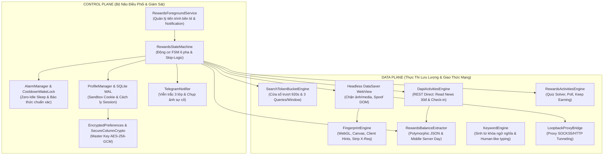
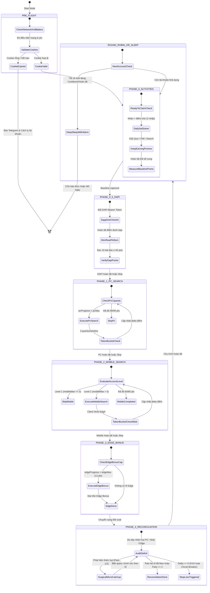
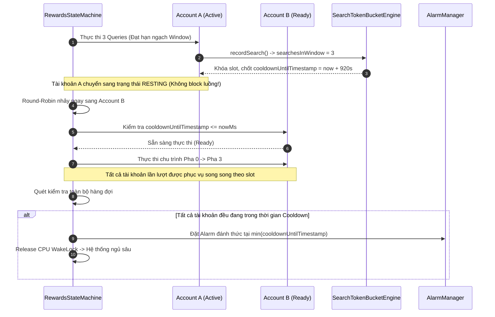
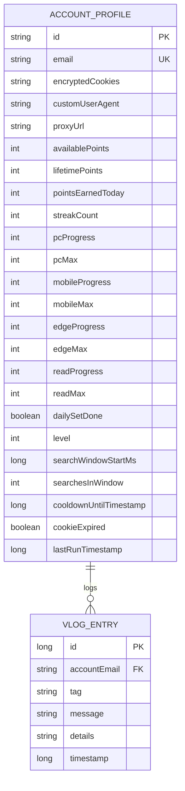
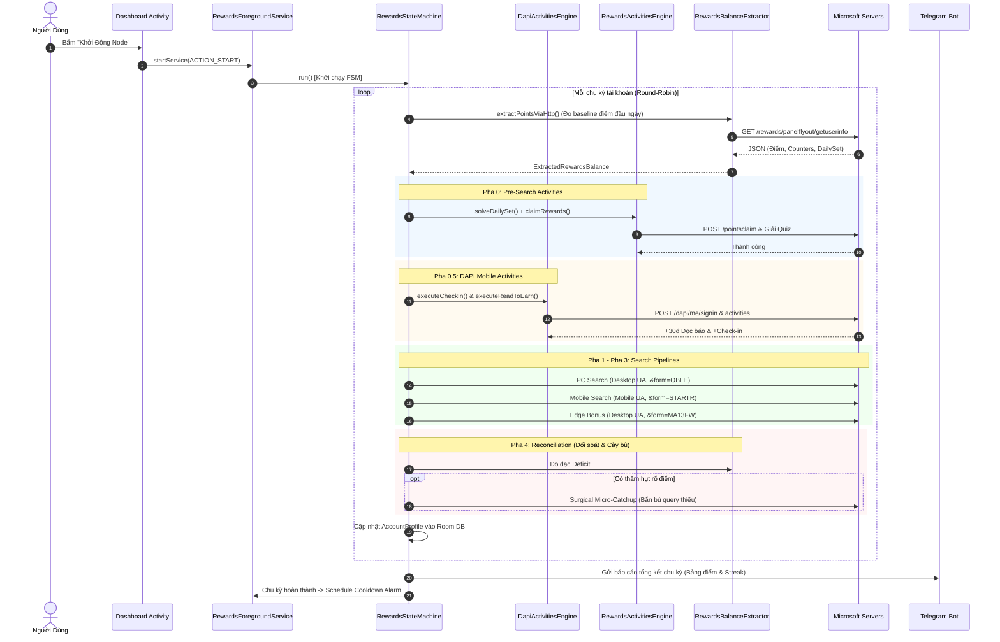

# 🏛️ RewardsNode — Tài Liệu Kiến Trúc Kỹ Thuật Chuyên Sâu (v2.0.0)

> **Tài liệu đặc tả kiến trúc nội bộ (System Architecture & Technical Design Specification)**  
> **Dự án:** RewardsNode — Autonomous Microsoft Rewards Engine for Android  
> **Phiên bản:** 2.0.0-PROD  
> **Nền tảng:** Android Native (100% Pure Android SDK, Kotlin Coroutines, Room SQLite WAL)

---

## 📑 Mục Lục
1. [Triết Lý Thiết Kế & Tổng Quan Hệ Thống](#1-triết-lý-thiết-kế--tổng-quan-hệ-thống)
2. [Phân Tách Ranh Giới: Control Plane vs Data Plane](#2-phân-tách-ranh-giới-control-plane-vs-data-plane)
3. [Máy Trạng Thái Điều Phối (RewardsStateMachine) & 6 Pha Tuần Tự](#3-máy-trạng-thái-điều-phối-rewardsstatemachine--6-pha-tuần-tự)
4. [Động Cơ Quản Lý Hạn Ngạch SearchTokenBucketEngine & Clock-Drift](#4-động-cơ-quản-lý-hạn-ngạch-searchtokenbucketengine--clock-drift)
5. [Giải Phóng Tắc Nghẽn Đầu Hàng (Eliminating Head-of-Line Blocking)](#5-giải-phóng-tắc-nghẽn-đầu-hàng-eliminating-head-of-line-blocking)
6. [Bóc Tách JSON Đa Hình (Polymorphic Schema) & Bí Quyết Middle Server Day](#6-bóc-tách-json-đa-hình-polymorphic-schema--bí-quyết-middle-server-day)
7. [Mô Hình Dữ Liệu & Cách Ly Session Đa Tài Khoản](#7-mô-hình-dữ-liệu--cách-ly-session-đa-tài-khoản)
8. [Sơ Đồ Tuần Tự Toàn Vòng Đời (End-to-End Sequence Diagram)](#8-sơ-đồ-tuần-tự-toàn-vòng-đời-end-to-end-sequence-diagram)
9. [Cơ Chế Phòng Vệ Tự Động & Circuit Breakers](#9-cơ-chế-phòng-vệ-tự-động--circuit-breakers)

---

## 1. Triết Lý Thiết Kế & Tổng Quan Hệ Thống

RewardsNode được thiết kế dựa trên 4 trụ cột kỹ thuật cốt lõi:

1. **Zero-Trust & Pure Native SDK:** Không phụ thuộc bất kỳ thư viện bên thứ ba cồng kềnh nào (không dùng Retrofit, OkHttp, RxJava hay Selenium/Appium). Toàn bộ hệ thống chạy trên Kotlin Coroutines thuần và Android SDK tiêu chuẩn (`HttpURLConnection`, `android.webkit.WebView`, `android.app.AlarmManager`, `android.os.PowerManager`).
2. **Resource-Constrained Resilience (Tiết Kiệm Tài Nguyên Tối Đa):** Tự động chuyển đổi giữa chu kỳ xử lý tích cực (Active Processing) và trạng thái ngủ sâu (Deep Sleep) giải phóng hoàn toàn CPU WakeLock, kéo dài tuổi thọ pin thiết bị di động.
3. **Closed-Loop Delta Tracking (Kiểm Soát Vòng Kín Theo Biến Thiên Điểm):** Không bao giờ giả định rằng việc gửi yêu cầu thành công đồng nghĩa với việc nhận được điểm thưởng. Mọi hành động đều được kiểm chứng thông qua $\Delta \text{Points} = \text{Points}_{t+1} - \text{Points}_t$.
4. **Non-blocking Multi-tenant Concurrency:** Hệ thống quản lý song song hàng chục tài khoản trên một thiết bị mà không bao giờ để một tài khoản bị lỗi/cooldown làm tê liệt tiến độ của các tài khoản khác.

---

## 2. Phân Tách Ranh Giới: Control Plane vs Data Plane

Hệ thống phân chia ranh giới vật lý và logic nghiêm ngặt giữa tầng điều khiển (**Control Plane**) và tầng truyền tải dữ liệu (**Data Plane**):



### 2.1. Control Plane (Mặt Phẳng Điều Khiển)
- **`RewardsForegroundService`:** Trạm neo tiến trình Android, ngăn chặn hệ điều hành thu hồi bộ nhớ (OOM Killer). Cung cấp kênh thông báo trạng thái trực quan cho người dùng.
- **`RewardsStateMachine`:** Bộ điều phối trung tâm quản lý luồng chuyển trạng thái FSM, tính toán delta điểm, ra quyết định bỏ qua (skip), cày bù (reconciliation) hoặc cách ly an toàn (circuit breaker).
- **`AlarmManager & WakeLockHelper`:** Cơ chế Zero-Idle WakeLock: chỉ giữ `PARTIAL_WAKE_LOCK` trong thời gian thực thi I/O thực sự; khi vào pha Cooldown 15 phút, trả lại 100% tài nguyên CPU cho hệ thống và đặt lịch báo thức chính xác bằng `setExactAndAllowWhileIdle()`.
- **`ProfileManager & Secure Storage`:** Quản lý vòng đời tài khoản, mã hóa cơ sở dữ liệu Room SQLite với chế độ Write-Ahead Logging (WAL) và chuẩn mã hóa `AES/GCM/NoPadding`.
- **`TelegramNotifier`:** Kênh viễn trắc từ xa với 3 tầng phòng thủ: tự động lọc ký tự Markdown v2, fallback văn bản thô khi lỗi 400 Bad Request, và tự động nén/gửi ảnh chụp màn hình khi gặp sự cố Captcha/Auth.

### 2.2. Data Plane (Mặt Phẳng Dữ Liệu)
- **`SearchTokenBucketEngine`:** Thuật toán Token Bucket kiểm soát lưu lượng tìm kiếm toán học, bảo vệ tài khoản không bao giờ vi phạm rate-limit của Microsoft.
- **`Headless DataSaver WebView`:** WebView tối ưu hóa, can thiệp vào `shouldInterceptRequest` qua `DataSaverWebViewClient` để chặn toàn bộ hình ảnh, font chữ, video và tracker thừa thãi, giảm 85% băng thông tiêu thụ.
- **`FingerprintEngine`:** Chèn mã JavaScript giả lập sâu các thông số WebGL, Canvas, màn hình, múi giờ và cấu trúc trình duyệt Edge Desktop/Mobile chính thống; xóa bỏ header `X-Requested-With`.
- **`DapiActivitiesEngine`:** Tương tác REST trực tiếp với các endpoint DAPI (`/dapi/me/signin`, `/dapi/me/activities`) của Bing Mobile App bằng token xác thực trích xuất từ cookie, hoàn thành nhiệm vụ Đọc báo và Check-in chỉ trong 2.5 giây.
- **`RewardsBalanceExtractor`:** Hệ thống trích xuất dữ liệu đa nguồn: Flyout API $\rightarrow$ Dashboard REST $\rightarrow$ DOM In-Page $\rightarrow$ Regex Fallback.
- **`KeywordEngine`:** Kho từ khóa phong phú kết hợp kỹ thuật xáo trộn ngữ nghĩa tự nhiên, tránh bị thuật toán chống gian lận phát hiện từ khóa lặp.

---

## 3. Máy Trạng Thái Điều Phối (RewardsStateMachine) & 6 Pha Tuần Tự

Để tối ưu hóa số điểm thu hoạch được trong ngày và giảm thiểu rủi ro, `RewardsStateMachine` thực thi một chu trình FSM tuần tự gồm **6 pha logic** khép kín:



### Chi Tiết Kỹ Thuật 6 Pha Tuần Tự:

| Pha | Tên Pha | Mục Tiêu & Cơ Chế | Rổ Điểm Thu Hoạch | Ghi Chú & Điều Kiện Bỏ Qua (Skip) |
| :--- | :--- | :--- | :--- | :--- |
| **0** | **Pre-Search Activities** | Kích hoạt `modal=pointsclaim` (Ready-to-Claim 2 nhấp), cào và giải quyết Daily Set (Quiz, Poll, This or That) và duyệt mảng `morePromotions`. | +30 đến +100 pts | Skip nếu `dailySetDone == true` và `claimablePoints == 0`. |
| **0.5** | **DAPI Mobile Activities** | Chuyển đổi cookie sang Sapphire Bearer Token, gửi request tuần tự tới `dapi/me/signin` (Check-in) và 10 request `dapi/me/activities` (Read to Earn). | +30 pts (Read) + 5-50 pts (Check-in) | Không mở WebView, hoàn thành trong ~2.5s. Tự động bỏ qua nếu đã đạt 60/60 điểm Bing App. |
| **1** | **PC Search (Desktop Edge)** | Giả lập Microsoft Edge Desktop Windows NT 10.0, truy vấn từ khóa kèm form code `&form=QBLH`. | +90 đến +150 pts | Skip ngay nếu `pcProgress >= pcMax`. Giới hạn theo Token Bucket. |
| **2** | **Mobile Search (Mobile Edge)** | Giả lập Microsoft Edge Mobile Android (`EdgA/128.0.0.0`), gắn Client Hints `sec-ch-ua-mobile: ?1`, form code `&form=STARTR&PC=EMMX01`. | +60 đến +100 pts | **Level Gating:** Tự động bỏ qua nếu tài khoản ở **Level 1** (`mobileMax == 0`). |
| **3** | **Edge Bonus (Desktop)** | Giả lập Edge Browser độc quyền với form code `&form=MA13FW&pc=EUPH`. | +12 pts (4 queries) | Bỏ qua nếu `edgeMax == 0` hoặc đã hoàn tất 12/12 điểm. |
| **4** | **Reconciliation Loop (Đối soát)** | Vòng lặp đối soát tính toán độ thâm hụt (`Deficit = Max - Progress`) trên cả 3 rổ tìm kiếm; kích hoạt cày bù phẫu thuật (Surgical Micro-Catchup) tối đa 2 pass. | Bù trọn vẹn điểm thiếu hụt | Ngắt ngay lập tức nếu kích hoạt Stop-Loss Circuit Breaker ($\Delta \text{Points} == 0$). |

---

## 4. Động Cơ Quản Lý Hạn Ngạch SearchTokenBucketEngine & Clock-Drift

Để vô hiệu hóa hoàn toàn thuật toán dò quét bot của Microsoft (vốn phạt nặng các hành vi tìm kiếm dồn dập trong khoảng thời gian ngắn), `SearchTokenBucketEngine` áp dụng mô hình toán học **Cửa Sổ Trượt Bổ Sung Đệm (Buffered Sliding Window Token Bucket)**:

### 4.1. Thông Số Định Mức Toán Học
- **Thời lượng cửa sổ ($W$):** $920.000\text{ ms}$ (tương đương 15 phút + 20 giây thời gian đệm bù trừ độ trễ mạng và sai số đồng hồ).
- **Hạn ngạch tối đa ($N$):** $3\text{ queries}$ trong một cửa sổ (tương ứng tối đa $9\text{ điểm}$ mỗi 15 phút theo quy tắc siết chặt nhất của Microsoft).

### 4.2. Khắc Phục Lỗi Lệch Xung Nhịp (Clock-Drift Fix)
Khi thiết bị di động di chuyển qua các trạm phát sóng (BTS), đồng bộ lại thời gian NTP, hoặc người dùng thay đổi múi giờ, hàm `System.currentTimeMillis()` có thể bị **nhảy lùi** ($now < start$) hoặc **nhảy vọt** ($now - start \gg W$).

Thuật toán tự động tái tạo cửa sổ xử lý an toàn:
```kotlin
if (account.searchWindowStartMs <= 0L || 
    nowMs < account.searchWindowStartMs || 
    nowMs - account.searchWindowStartMs >= WINDOW_DURATION_MS) {
    // Tự động Re-Anchor mốc thời gian bắt đầu
    account.searchWindowStartMs = nowMs
    account.searchesInWindow = 0
    if (account.cooldownUntilTimestamp <= nowMs) {
        account.cooldownUntilTimestamp = 0L
    }
    return true
}
```

---

## 5. Giải Phóng Tắc Nghẽn Đầu Hàng (Eliminating Head-of-Line Blocking)

### 5.1. Vấn Đề Head-of-Line (HoL) Blocking Trong Các Bot Cũ
Trong các hệ thống tự động hóa tuần tự sơ khai, khi Tài khoản $A$ bị Microsoft đưa vào trạng thái Cooldown 15 phút, bot sẽ gọi hàm `Thread.sleep(15 * 60 * 1000)`.  
**Hậu quả:** Toàn bộ hàng đợi phía sau gồm Tài khoản $B, C, D...$ bị đóng băng hoàn toàn. Nếu có 5 tài khoản, thời gian chạy một chu kỳ có thể bị kéo dài từ 20 phút lên tới hơn 2.5 giờ!

### 5.2. Giải Pháp Non-blocking Round-Robin Dispatcher
RewardsNode triển khai cơ chế điều phối không chặn:



---

## 6. Bóc Tách JSON Đa Hình (Polymorphic Schema) & Bí Quyết Middle Server Day

### 6.1. Thách Thức Từ Microsoft Rewards REST API
Microsoft không công bố API chính thức cho bên thứ ba. Các payload trả về từ `https://www.bing.com/rewards/panelflyout/getuserinfo` và `https://rewards.bing.com/dashboard` liên tục thay đổi cấu trúc dữ liệu theo từng đợt A/B Testing hoặc vị trí địa lý:
- `counters` có thể là mảng `[ { name: "PC search", progress: 90, max: 90 } ]` hoặc đối tượng lồng `userStatus.counters.dailyPoint`.
- Trường điểm số có thể là kiểu số nguyên `90` hoặc chuỗi ký tự `"90"`.
- Trạng thái `dailySetPromotions` có thể nằm trực tiếp ở gốc `rootJson`, hoặc nằm trong `data`, `dashboard`, `promotions`, hay `userStatus`.

`RewardsBalanceExtractor` sử dụng kỹ thuật bóc tách mềm đa hình (Polymorphic Fallback Traversal):
```kotlin
val promos = dashObj?.optJSONObject("dailySetPromotions")
    ?: promotionsObj?.optJSONObject("dailySetPromotions")
    ?: userStatusObj?.optJSONObject("dailySetPromotions")
    ?: dataObj.optJSONObject("dailySetPromotions")
    ?: rootJson.optJSONObject("dailySetPromotions")
```

### 6.2. Bí Quyết Lõi: Giải Quyết Bài Toán "Middle Server Day"

Khi gọi API lấy danh sách nhiệm vụ Daily Set, Microsoft gửi về một cấu trúc dạng Map ngày tháng chứa dữ liệu của **3 ngày liên tiếp**:
```json
{
  "dailySetPromotions": {
    "10/25/2026": [ { "title": "Nhiệm vụ hôm qua (Đã hết hạn)", "complete": true } ],
    "10/26/2026": [ { "title": "Nhiệm vụ hôm nay (Cần giải)", "complete": false } ],
    "10/27/2026": [ { "title": "Nhiệm vụ ngày mai (Khóa)", "complete": false } ]
  }
}
```

#### Vấn Đề Lệch Múi Giờ:
- Máy chủ Microsoft tính ngày theo múi giờ Bờ Tây Hoa Kỳ (UTC-7 / Redmond Timezone), trong khi thiết bị người dùng có thể ở Việt Nam (UTC+7, đi trước 14 tiếng).
- Nếu parser ngây thơ lấy phần tử đầu tiên `keys[0]`, bot sẽ **giải nhầm nhiệm vụ của ngày hôm qua** $\rightarrow$ Không nhận được điểm.
- Nếu lấy phần tử cuối cùng `keys[keys.length - 1]`, bot sẽ cố giải **nhiệm vụ của ngày mai** $\rightarrow$ Bị từ chối (403 Forbidden).

#### Giải Pháp Middle Server Day Của RewardsNode:
```kotlin
val dDates = Object.keys(dailySetPromotions);
// Nếu API trả về đủ 3 ngày, luôn luôn chọn chính xác phần tử ở vị trí trung tâm (Hôm nay)
val chosenDate = dDates.length >= 3 ? dDates[Math.floor(dDates.length / 2)] : dDates[0];
```
Nhờ thuật toán neo ngày trung tâm, RewardsNode hoạt động ổn định 100% trên mọi múi giờ toàn cầu mà không bao giờ giải nhầm nhiệm vụ cũ.

---

## 7. Mô Hình Dữ Liệu & Cách Ly Session Đa Tài Khoản

Mỗi tài khoản được quản lý trong cơ sở dữ liệu `AppDatabase` (Room SQLite) dưới dạng thực thể độc lập `AccountProfile`:



### Cách Ly Session Tuyệt Đối (Session Boundary Isolation)
Khi chuyển từ Tài khoản 1 sang Tài khoản 2:
1. `ProfileManager.switchSession()` xóa sạch bộ nhớ tạm của WebView: `CookieManager.removeAllCookies()`, `WebStorage.deleteAllData()`.
2. Khởi tạo lại Container Cookie riêng biệt cho domain `.bing.com`, `.live.com`, `.microsoft.com`.
3. Gắn Proxy riêng biệt (nếu cấu hình) qua `LoopbackProxyBridge`.
4. Thiết lập User-Agent tương ứng với hệ điều hành và thiết bị mục tiêu.

---

## 8. Sơ Đồ Tuần Tự Toàn Vòng Đời (End-to-End Sequence Diagram)



---

## 9. Cơ Chế Phòng Vệ Tự Động & Circuit Breakers

Hệ thống tích hợp 4 bộ ngắt mạch an toàn (Safety Circuit Breakers):

1. **Arkose Labs / Captcha Interceptor:** Khi phát hiện iframe Arkose Labs hoặc trang giải đố Captcha xuất hiện trong DOM, ngay lập tức cô lập tài khoản, dừng mọi truy vấn, chụp ảnh màn hình WebView và gửi cảnh báo khẩn cấp lên Telegram.
2. **Frozen Balance Circuit Breaker:** Nếu một tài khoản thực hiện $N$ lượt tìm kiếm thành công về mặt mạng nhưng điểm số khả dụng không tăng ($\Delta \text{Points} == 0$), hệ thống kích hoạt chế độ đóng băng an toàn, dời lịch tài khoản sang ngày hôm sau để tránh bị gắn cờ bot.
3. **Auth Desync Detection:** Khi `isRewardsUser == false` hoặc cookie session bị rớt, hệ thống đánh dấu `cookieExpired = true` và tạm ngưng tài khoản, bảo vệ danh tính tài khoản không bị quét lỗi.
4. **Network & Battery Guard:** Tự động hoãn chu kỳ khi pin thiết bị $< 15\%$ mà chưa cắm sạc, hoặc khi mất kết nối mạng Wi-Fi (nếu người dùng bật chế độ "Chỉ chạy trên Wi-Fi").

---

*Tài liệu thuộc sở hữu dự án RewardsNode. Cập nhật lần cuối: 26/10/2026.*
