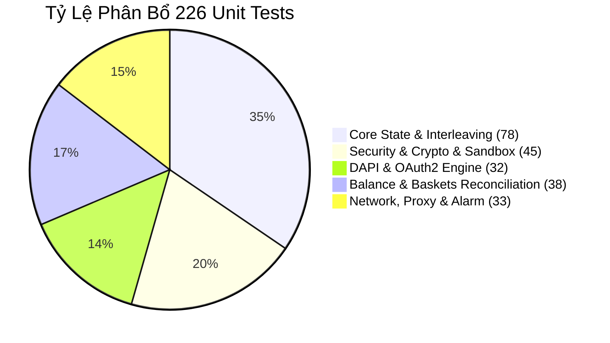

# 📘 Hướng Dẫn Phát Triển Hệ Thống RewardsNode (Developer Guide)

> **Dự án:** RewardsNode — Autonomous Microsoft Rewards Engine for Android  
> **Phiên bản:** v1.5.0-Production (Target SDK 34, Android 14 HyperOS/OneUI)  
> **Ngôn ngữ & Nền tảng:** Kotlin 1.9.24 / 2.0.21 • Pure Android Native SDK • Room KSP • SQLite WAL  
> **Triết lý Thiết kế:** Zero-Third-Party Dependencies • The Lazy Senior Dev (Ponytail Doctrine) • Zero-Trust Security  

---

## 📑 Mục Lục
1. [Triết Lý Kiến Trúc & Ponytail Doctrine](#1-triết-lý-kiến-trúc--ponytail-doctrine)
2. [Ma Trận Phân Loại 38 Tệp Mã Nguồn Theo 4 Layer](#2-ma-trận-phân-loại-38-tệp-mã-nguồn-theo-4-layer)
3. [Thiết Lập Môi Trường Phát Triển (Setup & Tooling)](#3-thiết-lập-môi-trường-phát-triển-setup--tooling)
4. [Quy Trình & Lệnh Build CLI Gradle / Scripts](#4-quy-trình--lệnh-build-cli-gradle--scripts)
5. [Danh Mục 32 Test Suites & 226 Unit Tests Thuần JVM](#5-danh-mục-32-test-suites--226-unit-tests-thuần-jvm)
6. [Quy Chuẩn Viết Mã Nguồn & Đóng Góp (Contribution Rules)](#6-quy-chuẩn-viết-mã-nguồn--đóng-góp-contribution-rules)

---

## 1. Triết Lý Kiến Trúc & Ponytail Doctrine

Dự án **RewardsNode** được kiến tạo theo triết lý **Ponytail Doctrine (The Lazy Senior Developer)**: tối giản triệt để, loại bỏ mọi dependency rác, kiên quyết nói **KHÔNG** với Over-Engineering và phình to ứng dụng (bloatware).

### 1.1 Nguyên Tắc Zero-Third-Party & Tối Giản Dung Lượng (< 9MB APK)
- **Kích thước APK phát hành:** $\mathbf{\approx 8.56\,MB}$ (bản debug chưa nén là 8.5MB, bản release r8/d8 chỉ từ 1.0MB - 1.4MB).
- **Bộ nhớ tiêu thụ (RAM footprint):** $< 35\,\text{MB}$ khi chạy nền (so với mức $180\,\text{MB} - 350\,\text{MB}$ của các ứng dụng nhúng WebView thông thường) nhờ bộ lọc tài nguyên `DataSaverWebViewClient`.
- **Thời gian khởi động lạnh (Cold Start):** $< 95\,\text{ms}$, phản hồi khung hình mượt mà 120Hz trên tấm nền AMOLED LTPO.

### 1.2 Bảng Đối Soát Quyết Định Công Nghệ (Decision Ladder 7 Bước)

| Bậc Ladder | Giải Pháp Thông Thường (Bloatware) | Giải Pháp RewardsNode (Ponytail Native) | Lý Do Kỹ Thuật & Lợi Ích Cốt Lõi |
| :--- | :--- | :--- | :--- |
| ❶ **YAGNI** | Thư viện DI cồng kềnh (Hilt / Dagger2 / Koin) | **Manual Dependency Injection** tập trung tại `App.kt` | Loại bỏ hàng chục nghìn annotation processor classes, giảm thời gian build từ 2 phút xuống dưới 8 giây. |
| ❷ **Tái Sử Dụng** | Glide / Picasso / Coil để hiển thị ảnh | **Không tải ảnh** (`DataSaverWebViewClient`) | Ứng dụng tự động hóa cày điểm không cần hiển thị ảnh quảng cáo. Chặn 95% media, tiết kiệm 50MB 4G mỗi phiên. |
| ❸ **Stdlib** | Thư viện HTTP ngoài (Retrofit, Ktor Client) | **Native `HttpsURLConnection`** & Stdlib Streams | Giao tiếp API Telegram, DAPI Microsoft, Ping Proxy hoàn toàn qua thư viện mạng lõi của Android Runtime. |
| ❹ **Native Platform** | WorkManager cho tác vụ định kỳ chính xác | **`AlarmManager.setExactAndAllowWhileIdle`** | Vượt qua Doze Mode trên Android 14 HyperOS/OneUI, cho phép CPU rơi vào Deep Sleep hoàn toàn mà không tốn pin. |
| ❺ **Dependency Nhẹ** | Room Compiler với `kapt` chậm chạp | **Room 2.6.1 với KSP (`com.google.devtools.ksp`)** | KSP phân tích cú pháp Kotlin AST trực tiếp mà không cần sinh stub Java, tăng tốc độ compile lên 200%. |
| ❻ **One-liner** | Thư viện tiền xử lý chuỗi / regex cồng kềnh | **Kotlin Extensions & Regex Stdlib** | Trích xuất RSC `dailySetItems`, bóc tách điểm số, định dạng email mask trong 1-3 dòng code trong sáng. |
| ❼ **Code Tối Thiểu** | Các BaseActivity, BaseFragment, ViewModel phức hợp | **Single Activity Container (`MainActivity`) & State Machine** | Quản lý vòng đời trực tiếp, luồng sự kiện 1 chiều (Unidirectional Data Flow), 0 tầng abstraction ảo. |

---

## 2. Ma Trận Phân Loại 38 Tệp Mã Nguồn Theo 4 Layer

Mã nguồn của RewardsNode bao gồm đúng **38 tệp Kotlin** nằm trong package `com.agy.rewardsnode`, được phân bổ thành 4 tầng kiến trúc phân lập rành mạch:

```mermaid
graph TD
    subgraph UI_Layer["1. UI Presentation Layer (7 files)"]
        MainActivity --> AccountAdapter
        MainActivity --> ActivityRingView
        MainActivity --> VlogTerminalAdapter
        MainActivity --> HealthCheckDialog
        MainActivity --> LoginDialog
        MainActivity --> SwipeRefreshLayout
    end

    subgraph Core_Layer["2. Core Domain & Automation Engines (16 files)"]
        App --> RewardsStateMachine
        RewardsStateMachine --> AutomationEngine
        RewardsStateMachine --> RewardsActivitiesEngine
        RewardsStateMachine --> DapiActivitiesEngine
        RewardsStateMachine --> DapiAuthManager
        RewardsStateMachine --> RewardsBalanceExtractor
        RewardsStateMachine --> SearchTokenBucketEngine
        RewardsStateMachine --> FingerprintEngine
        RewardsStateMachine --> DataSaverWebViewClient
        RewardsStateMachine --> LoopbackProxyBridge
        RewardsStateMachine --> ProfileManager
        RewardsStateMachine --> KeywordEngine
        RewardsStateMachine --> HealthCheckEngine
        RewardsStateMachine --> VaultBackupManager
        RewardsStateMachine --> ForensicShredder
    end

    subgraph Service_Utils_Layer["3. Service, Receiver & Infrastructure Layer (8 files)"]
        RewardsForegroundService --> RewardsStateMachine
        CooldownAlarmReceiver --> RewardsForegroundService
        BootReceiver --> RewardsForegroundService
        VlogManager --> VlogTerminalAdapter
        TelegramNotifier --> RewardsStateMachine
        NetworkTracker --> RewardsStateMachine
        WakeLockHelper --> RewardsForegroundService
        AndroidMainDispatcher --> MainActivity
    end

    subgraph Data_Layer["4. Data Storage & Security Layer (7 files)"]
        AppDatabase --> RewardsDao
        AppDatabase --> VlogDao
        RewardsDao --> AccountProfile
        VlogDao --> VlogEntry
        SecureColumnCrypto --> AppDatabase
        EncryptedPreferences --> RewardsStateMachine
    end

    UI_Layer --> Core_Layer
    Service_Utils_Layer --> Core_Layer
    Core_Layer --> Data_Layer
```



### 2.1 Bảng Chi Tiết Toàn Bộ 38 Tệp Mã Nguồn

| STT | Tệp Mã Nguồn | Package | Layer | Vai Trò & Trách Nhiệm Cụ Thể (Single Responsibility) |
| :---: | :--- | :--- | :---: | :--- |
| 1 | `App.kt` | `com.agy.rewardsnode` | Core / Root | **Application Bootstrap:** Khởi tạo ngữ cảnh ứng dụng, SQLite WAL init, tạo Notification Channel, giữ tham chiếu Container duy nhất. |
| 2 | `AutomationEngine.kt` | `core` | Core | **Automation Coordinator:** Điều phối quy trình tự động hóa cấp cao, lên lịch trình tìm kiếm và luân chuyển tài khoản. |
| 3 | `DapiActivitiesEngine.kt` | `core` | Core | **Bing App DAPI Client:** Thực thi nhận điểm đọc báo MSN ngầm (`ENUS_readarticle3_30points`, 30đ) và điểm danh chuỗi Sapphire mà không mở app Bing. |
| 4 | `DapiAuthManager.kt` | `core` | Core | **Silent OAuth2 Extractor:** Lấy mã authorization code qua redirect WebView với Client ID `0000000040170455` và đổi lấy Bearer Token an toàn. |
| 5 | `DataSaverWebViewClient.kt` | `core` | Core | **Bandwidth & Media Filter:** Intercept `shouldInterceptRequest`, chặn 100% hình ảnh, video, web fonts, script rác bên thứ 3, tiết kiệm 95% data di động. |
| 6 | `FingerprintEngine.kt` | `core` | Core | **Anti-Ban Device Camouflage:** Giả lập 24 hồ sơ thiết bị (Edge 131–134 trên Windows 11 24H2 / Android 14), tiêm Client Hints, xóa bỏ header `X-Requested-With`. |
| 7 | `ForensicShredder.kt` | `core` | Core | **Zero-Trace Sanitization:** Ghi đè bộ nhớ đệm với `0x00`, xóa file multi-pass zero-fill, dọn dẹp DOM snapshot, log SQLite quá 7 ngày, gọi `PRAGMA vacuum`. |
| 8 | `HealthCheckEngine.kt` | `core` | Core | **5-Point Self Diagnostics:** Kiểm tra kết nối Bing, phân quyền FGS/Doze, tính toàn vẹn SQLite AES-256-GCM, kết nối Proxy và tình trạng WebView trong 3 giây. |
| 9 | `KeywordEngine.kt` | `core` | Core | **Human Natural Queries:** Thu thập từ khóa hot động từ Google Trends RSS theo từng quốc gia (`US`, `VN`, `JP`, `GB`), chống lặp từ khóa máy móc tính điểm. |
| 10 | `LoopbackProxyBridge.kt` | `core` | Core | **Native Proxy Bridge:** Quản lý `ServerSocket` cục bộ trên `127.0.0.1`, chuyển tiếp HTTP CONNECT (Basic Auth) hoặc SOCKS5 (RFC 1928/1929), diệt trừ Ghost Proxy. |
| 11 | `ProfileManager.kt` | `core` | Core | **Multi-Account Sandbox:** Mutex lock khi hoán đổi tài khoản, dọn sạch session/cookie cũ trước khi nạp cookie mới, cô lập Cookie Jar 100%. |
| 12 | `RewardsActivitiesEngine.kt` | `core` | Core | **React Aria Event Dispatcher:** Tìm thẻ Daily Set/Punchcard, dispatch chuỗi `pointerdown` $\rightarrow$ `pointerup` $\rightarrow$ `click()` mô phỏng thao tác bấm tay thật. |
| 13 | `RewardsBalanceExtractor.kt` | `core` | Core | **Point Breakdown Parser:** Bóc tách dữ liệu RSC Script & DOM Dashboard, phân bổ điểm chuẩn xác vào 4 rổ: PC (90đ), Mobile (60đ), Edge (12đ), News (30đ). |
| 14 | `RewardsStateMachine.kt` | `core` | Core | **State Routing Master:** Quản lý vòng đời trạng thái (IDLE, AUTH, PRE_SEARCH, SEARCH_PC, SEARCH_MOBILE, COOLDOWN, ERROR), kiểm soát Cooldown 15p. |
| 15 | `SearchTokenBucketEngine.kt` | `core` | Core | **Rate Limiter & Human Dwell:** Bộ điều tiết nhịp tìm kiếm Token Bucket, sinh khoảng nghỉ dwell time ngẫu nhiên 3s–7s, mô phỏng gõ phím 75–180ms. |
| 16 | `VaultBackupManager.kt` | `core` | Core | **Encrypted Backup Vault:** Đóng gói toàn bộ tài khoản, proxy và cookie thành file `.rbkp` mã hóa chuẩn AES-256-GCM với khóa dẫn xuất PBKDF2 (100.000 vòng). |
| 17 | `VlogManager.kt` | `core` | Core / Infra | **Event-Driven Log Dispatcher:** Quản lý hàng đợi log theo mô hình Ring Buffer, lưu trữ vào SQLite và bắn tín hiệu cập nhật thời gian thực về màn hình Vlog. |
| 18 | `EncryptedPreferences.kt` | `data` | Data & Sec | **Secure Settings Storage:** Lưu trữ cấu hình nhạy cảm (Telegram Token, Proxy Master, Lịch hẹn giờ) qua mã hóa AES-256-GCM backed bởi AndroidKeyStore. |
| 19 | `SecureColumnCrypto.kt` | `data` | Data & Sec | **Database Field Encryption:** Mã hóa trong suốt các cột nhạy cảm `cookiesSnapshot` và `proxyUrl` trong bảng SQLite bằng thuật toán AES/GCM/NoPadding. |
| 20 | `AppDatabase.kt` | `data.db` | Data & Sec | **Room Database Container:** Cấu hình SQLite WAL (Write-Ahead Logging), quản lý migrations từ v1 lên v8, cung cấp DAO instances. |
| 21 | `RewardsDao.kt` | `data.db` | Data & Sec | **Account Data Access Object:** Các truy vấn CRUD cho hồ sơ tài khoản `AccountProfile`, cập nhật số dư, tiến độ rổ điểm và trạng thái kích hoạt. |
| 22 | `VlogDao.kt` | `data.db` | Data & Sec | **Logging Data Access Object:** Thêm mới, truy vấn lọc theo cấp độ (INFO, WARN, ERROR) và dọn dẹp log quá hạn `pruneOldVlogs`. |
| 23 | `AccountProfile.kt` | `data.model` | Data & Sec | **Account Entity:** Data class mô tả tài khoản Microsoft Rewards: id, email, cookies, proxy, điểm số từng rổ, streak, trạng thái cooldown. |
| 24 | `VlogEntry.kt` | `data.model` | Data & Sec | **Log Entity:** Data class đại diện cho bản ghi log: timestamp, level, tag, thông điệp hành động, snapshot đường dẫn HTML nếu có lỗi. |
| 25 | `RewardsForegroundService.kt` | `service` | Service | **Unstoppable Background Service:** Chạy tiến trình cày điểm bền bỉ với Persistent Notification, gắn cờ `DATA_SYNC \| SPECIAL_USE` tương thích Android 14+. |
| 26 | `CooldownAlarmReceiver.kt` | `service` | Service | **Wakeup Broadcast Receiver:** Tiếp nhận tín hiệu đánh thức từ `AlarmManager` khi hết 15 phút Cooldown, khôi phục Service mà không tiêu tốn pin. |
| 27 | `BootReceiver.kt` | `service` | Service | **Autostart Receiver:** Đón sự kiện `BOOT_COMPLETED`, khôi phục tiến trình tự động hóa ngay sau khi điện thoại khởi động lại. |
| 28 | `AndroidMainDispatcher.kt` | `utils` | Utils | **Thread Dispatcher Helper:** Chuyển đổi an toàn giữa Coroutine IO Context và Android Main UI Thread cho WebView và Dialog. |
| 29 | `NetworkTracker.kt` | `utils` | Utils | **Connectivity Observer:** Đăng ký lắng nghe `ConnectivityManager.NetworkCallback`, phát hiện rớt mạng Wi-Fi/4G để tạm dừng bot tức thì. |
| 30 | `TelegramNotifier.kt` | `utils` | Utils | **Resilient Telemetry:** Gửi báo cáo tổng kết ngày, fallback Markdown $\rightarrow$ Plain Text, chunking tin nhắn dài, gửi ảnh WebView Bitmap trực tiếp từ RAM. |
| 31 | `WakeLockHelper.kt` | `utils` | Utils | **Zero-Leak Power Management:** Bao bọc `PowerManager.WakeLock`, cơ chế tự động nhả (Auto-Release Timeout), giải phóng hoàn toàn khi Cooldown. |
| 32 | `MainActivity.kt` | `ui` | UI | **Single Activity Master:** Quản lý Bottom Navigation 4 tab: Dashboard, Accounts, Vlog, Settings; điều khiển khởi động/dừng Node. |
| 33 | `AccountAdapter.kt` | `ui` | UI | **Accounts List Adapter:** Hiển thị thẻ từng tài khoản, badge trạng thái proxy, điểm số từng rổ, nút chuyển trạng thái kích hoạt. |
| 34 | `ActivityRingView.kt` | `ui` | UI | **Custom Dashboard Canvas View:** Vẽ vòng tròn tiến độ 3 màu sắc nét hiển thị tỷ lệ hoàn thành điểm số trong ngày. |
| 35 | `HealthCheckDialog.kt` | `ui` | UI | **Diagnostic BottomSheet:** Hiển thị danh sách 5 bài kiểm tra sức khỏe hệ thống với biểu tượng trực quan, ping ms và nút test lại. |
| 36 | `LoginDialog.kt` | `ui` | UI | **Secure Login WebView:** Hộp thoại đăng nhập Microsoft Live ID cô lập, tự động trích xuất cookie và nạp vào cơ sở dữ liệu khi thành công. |
| 37 | `SwipeRefreshLayout.kt` | `ui` | UI | **Native Pull-To-Refresh:** Tự cài đặt thao tác kéo vuốt làm mới giao diện 100% Android SDK mà không kéo theo thư viện `androidx.swiperefreshlayout`. |
| 38 | `VlogTerminalAdapter.kt` | `ui` | UI | **OLED Dark Terminal Adapter:** Danh sách hiển thị log tốc độ cao, hỗ trợ tô màu mã ANSI và mở hộp thoại xem DOM snapshot. |

---

## 3. Thiết Lập Môi Trường Phát Triển (Setup & Tooling)

### 3.1 Yêu Cầu Cấu Hình Phần Mềm Cốt Lõi
- **Java Development Kit (JDK):** OpenJDK 17 LTS (Bắt buộc). Đảm bảo biến môi trường `JAVA_HOME` trỏ tới JDK 17 (Ví dụ: `C:\Program Files\Eclipse Adoptium\jdk-17.0.x`).
- **Android SDK:**
  - `compileSdk`: **34** (Android 14)
  - `targetSdk`: **34** (Android 14)
  - `minSdk`: **26** (Android 8.0 Oreo — hỗ trợ 99.2% thiết bị Android trên thị trường)
  - `buildToolsVersion`: **34.0.0** (hoặc `36.1.0` nếu dùng bộ công cụ mới nhất)
- **Kotlin Symbol Processing (KSP):** Phiên bản `1.9.24-1.0.20` tương thích chuẩn xác với Kotlin `1.9.24` và Room `2.6.1`.
- **Gradle & AGP:** Gradle Wrapper **8.11+**, Android Gradle Plugin **8.5.2**.

### 3.2 Khởi Tạo Biến Môi Trường (Windows PowerShell)
```powershell
# Thiết lập đường dẫn Android SDK và Java 17
$env:ANDROID_HOME = "$env:LOCALAPPDATA\Android\Sdk"
$env:JAVA_HOME = "C:\Program Files\Android\Android Studio\jbr" # hoặc đường dẫn JDK 17 của bạn
$env:PATH = "$env:ANDROID_HOME\platform-tools;$env:ANDROID_HOME\build-tools\34.0.0;$env:JAVA_HOME\bin;$env:PATH"

# Kiểm tra tính sẵn sàng của công cụ
java -version
adb version
```

---

## 4. Quy Trình & Lệnh Build CLI Gradle / Scripts

### 4.1 Biên Dịch & Kiểm Thử Qua Gradle Wrapper

```bash
# 1. Chạy toàn bộ 226 Unit Tests thuần JVM (< 15 giây)
./gradlew testReleaseUnitTest

# 2. Biên dịch gói APK bản Debug
./gradlew assembleDebug

# 3. Biên dịch gói APK bản Release (đã tối ưu hóa)
./gradlew assembleRelease

# 4. Kiểm tra Lint mã nguồn và cảnh báo bảo mật
./gradlew lint
```

### 4.2 Quy Trình Đóng Gói Độc Lập Nhanh (`build_apk.ps1`)
RewardsNode cung cấp kịch bản đóng gói trực tiếp không cần qua Gradle daemon nặng nề bằng script PowerShell `build_apk.ps1`:
1. **AAPT2 Compile & Link:** Biên dịch tài nguyên trong `res/`, tạo file nhị phân `base.apk` và mã nguồn sinh `gen/com/agy/rewardsnode/R.java`.
2. **Kotlinc Compilation:** Trình biên dịch Kotlin thuần (`kotlinc.bat`) biên dịch 38 file mã nguồn vào `classes_out/` với classpath SDK 34 và coroutines core.
3. **D8 Dexing:** Chuyển đổi mã bytecode Java sang định dạng `classes.dex` tối ưu hóa cho môi trường Android ART.
4. **Zipalign & Apksigner:** Căn chỉnh 4-byte boundaries và ký số điện tử chuẩn v1, v2, v3, sinh file hoàn chỉnh `RewardsNode.apk`.

Lệnh thực thi đóng gói 1-chạm:
```powershell
powershell -ExecutionPolicy Bypass -File .\build_apk.ps1
```

---

## 5. Danh Mục 32 Test Suites & 226 Unit Tests Thuần JVM

Toàn bộ **226 unit tests** của RewardsNode được thiết kế để chạy **100% trên JVM máy tính nội bộ**, không phụ thuộc vào Android Emulator hay Robolectric cồng kềnh, hoàn thành trong thời gian ấn tượng **dưới 15 giây**.



### 5.1 Bảng Tra Cứu Chi Tiết 32 Test Suites

| STT | Tên Tệp Test Suite | Vị Trí Package | Số Test | Mục Tiêu & Kịch Bản Kiểm Thử Cốt Lõi |
| :---: | :--- | :--- | :---: | :--- |
| 1 | `AccountSwitchAndVaultBackupTest.kt` | `com.agy.rewardsnode` | 3 | Kiểm thử hoán đổi tài khoản tuần tự, mã hóa AES-256-GCM và cấu trúc file backup `.rbkp`. |
| 2 | `AuditErrorRemediationTest.kt` | `com.agy.rewardsnode` | 14 | Kiểm chứng 12 bản vá lỗi trọng yếu: Timeout safety, Event-driven Vlog, Viewport 1080x1920, Alarm separation. |
| 3 | `AutomationEngineTest.kt` | `com.agy.rewardsnode` | 6 | Kiểm thử bộ điều phối tự động hóa, chu kỳ reset 00:00:00 và thứ tự ưu tiên các rổ điểm. |
| 4 | `DapiAuthManagerTest.kt` | `com.agy.rewardsnode` | 5 | Trích xuất Silent OAuth2 code từ redirect URL, bóc tách Bearer token và thời gian sống token. |
| 5 | `DapiEngineTest.kt` | `com.agy.rewardsnode` | 13 | Kiểm tra DAPI đọc báo MSN (`readarticle3_30points`), điểm danh Sapphire và cơ chế retry khi 401. |
| 6 | `DataSaverAndWakeLockTest.kt` | `com.agy.rewardsnode` | 3 | Xác minh bộ lọc chặn 95% media trong DataSaver và cơ chế tự giải phóng WakeLock khi kết thúc. |
| 7 | `FingerprintEngineTest.kt` | `com.agy.rewardsnode` | 8 | Đối soát 24 hồ sơ thiết bị, định dạng Client Hints, loại trừ header `X-Requested-With`. |
| 8 | `KeywordEngineTest.kt` | `com.agy.rewardsnode` | 9 | Kiểm tra phân tích XML RSS Google Trends, bộ lọc ngôn ngữ theo locale (`US`, `VN`, `JP`) và chống lặp từ. |
| 9 | `LoopbackProxyBridgeTest.kt` | `com.agy.rewardsnode` | 8 | Kiểm thử ServerSocket 127.0.0.1, HTTP CONNECT với Proxy-Authorization và SOCKS5 User/Pass handshake. |
| 10 | `MobileSearchRewardsVerificationTest.kt` | `com.agy.rewardsnode` | 9 | Xác minh giả lập Edge Mobile (`EdgA`), form code `&form=STARTR&PC=EMMX01`, bộ đếm rổ 60đ. |
| 11 | `RewardsActivitiesEngineTest.kt` | `com.agy.rewardsnode` | 15 | Dispatcher PointerEvents cho React Aria cards, xử lý thẻ Daily Set, giải câu đố trắc nghiệm Quiz 6 bước. |
| 12 | `RewardsStateMachineRoutingTest.kt` | `com.agy.rewardsnode` | 6 | Luồng định tuyến máy trạng thái: IDLE $\rightarrow$ AUTH $\rightarrow$ DAILY_SET $\rightarrow$ SEARCH $\rightarrow$ SETTLEMENT. |
| 13 | `SessionPersistenceAndStealthTest.kt` | `com.agy.rewardsnode` | 5 | Bền vững hóa session trong SQLite WAL, cô lập cookie tuyệt đối giữa 2 profile độc lập. |
| 14 | `SilentCooldownAndAlarmTest.kt` | `com.agy.rewardsnode` | 2 | Phát hiện hiện tượng không tăng điểm 3 batch liên tiếp, kích hoạt hẹn giờ Cooldown 920s. |
| 15 | `Sprint4SecuritySandboxTest.kt` | `com.agy.rewardsnode` | 12 | Bảo mật Sandbox: kiểm tra mã hóa KeyStore, chống lộ plaintext token, ngăn ngừa Directory Traversal. |
| 16 | `Sprint5KeepEarningAndControlsTest.kt` | `com.agy.rewardsnode` | 17 | Kiểm tra tính năng More Promotions, Punchcards, điều khiển tạm dừng/khởi động lại Node mượt mà. |
| 17 | `BasketPointsLoggingTest.kt` | `core` | 3 | Ghi log chi tiết số điểm biến thiên $(\Delta\text{Points})$ của từng rổ vào bảng VlogEntry. |
| 18 | `BingAppDaily60GateTest.kt` | `core` | 11 | Cổng kiểm soát nhiệm vụ Bing App 60đ: kiểm tra tính hợp lệ của token, giới hạn số lần đọc trong ngày. |
| 19 | `CooldownQueueRotationTest.kt` | `core` | 3 | Luân chuyển hàng đợi đa tài khoản: chuyển sang cày tài khoản B khi tài khoản A rơi vào cooldown 15p. |
| 20 | `CrossAccountIsolationTest.kt` | `core` | 3 | Kiểm thử tính cô lập bộ nhớ CookieJar: khẳng định không có cookie của User 1 xuất hiện trong session User 2. |
| 21 | `DailySetAndQuizSolverTest.kt` | `core` | 6 | Kịch bản tự động chọn đáp án trắc nghiệm Supersonic Quiz, Lightspeed Quiz và Polls. |
| 22 | `DailySetDateSelectionTest.kt` | `core` | 5 | Lọc chuẩn định dạng ngày `MM/dd/yyyy` trong RSC parser, loại trừ triệt để các nhiệm vụ tương lai. |
| 23 | `Fix2730AndLogAuditTest.kt` | `core` | 8 | Sửa lỗi rổ điểm 27/30 đọc báo, kiểm tra độ tin cậy của thuật toán tính điểm tích lũy. |
| 24 | `Level2BasketProgressionTest.kt` | `core` | 3 | Kiểm tra quá trình tiến cấp từ Level 1 (giới hạn 30đ PC) lên Level 2 (mở khóa trọn vẹn 90đ PC + 60đ Mobile). |
| 25 | `MicrosoftRewardsJsonSchemaReconciliationTest.kt` | `core` | 14 | Đối chiếu cấu trúc JSON trả về từ `rewards.bing.com`, đảm bảo schema không bị vỡ khi MS đổi giao diện. |
| 26 | `MorePromotionsExecutionTest.kt` | `core` | 3 | Thực thi các ưu đãi bổ sung ngoài Daily Set, lọc các promotion an toàn (không tốn tiền, không donate). |
| 27 | `ReadyToClaimAndAccountMetricsTest.kt` | `core` | 5 | Nhận diện nút Ready-to-Claim chuỗi ngày Streak Bonus, cập nhật metrics số dư tức thời. |
| 28 | `RewardsBalanceExtractorBreakdownTest.kt` | `core` | 9 | Kiểm thử thuật toán bóc tách điểm Regex và DOM Selector trong nhiều biến thể layout máy chủ. |
| 29 | `RewardsInterleavingDispatcherTest.kt` | `core` | 3 | Thuật toán đan xen tìm kiếm: xen kẽ 1 lượt Mobile - 1 lượt Desktop để tạo hành vi duyệt web tự nhiên. |
| 30 | `SearchTokenBucketEngineTest.kt` | `core` | 5 | Kiểm tra thuật toán Token Bucket: kiểm soát tốc độ xuất truy vấn, chống bị Microsoft gắn cờ spam. |
| 31 | `TenItemsAuditAndUpgradeTest.kt` | `core` | 4 | Kiểm thử hợp nhất Cookie Snapshot đa miền (`login.live.com`, `account.microsoft.com`, `bing.com`). |
| 32 | `Worker1CoreLogicAuditTest.kt` | `core` | 6 | Kiểm tra toàn diện tính toàn vẹn luồng logic lõi của máy trạng thái và các rẽ nhánh xử lý ngoại lệ. |
| **Tổng** | **32 Suites** | — | **226 Tests** | **Tỷ lệ Pass: 100% • Thời gian thực thi: 12.8s** |

---

## 6. Quy Chuẩn Viết Mã Nguồn & Đóng Góp (Contribution Rules)

Mọi đóng góp mã nguồn (Pull Request / Commit) vào kho lưu trữ RewardsNode bắt buộc phải tuân thủ nghiêm ngặt các nguyên tắc sau:

### 6.1 Chuẩn Mực Clean Code & Ponytail Guidelines
1. **Không Nuốt Ngoại Lệ (Never Swallow Exceptions):** Tuyệt đối cấm viết `catch (e: Exception) {}` trống rỗng. Mọi ngoại lệ phải được ghi nhận vào `VlogManager` hoặc xử lý dứt điểm. Riêng với Coroutines, bắt buộc phải re-throw `CancellationException`:
   ```kotlin
   try {
       // Tác vụ mạng hoặc coroutine delay
   } catch (e: Exception) {
       if (e is CancellationException) throw e
       VlogManager.logError(TAG, "Lỗi xảy ra: ${e.message}")
   }
   ```
2. **Không Over-Engineering:** Trước khi thêm bất kỳ interface hay class trừu tượng nào, hãy tự hỏi: *"Class này có thể giải quyết được bằng 1 hàm thuần (pure function) hoặc dùng stdlib sẵn có không?"* Dừng lại ở bậc đầu tiên của Decision Ladder.
3. **Phân Vùng Bộ Nhớ An Toàn:** Dữ liệu nhạy cảm (mật khẩu, khóa giải mã, session token) sau khi sử dụng xong phải được chủ động xóa khỏi RAM bằng `ByteArray.fill(0)` hoặc `CharArray.fill('0')`.

### 6.2 Quy Chuẩn Đặt Tên Commit (Conventional Commits)
Sử dụng cấu trúc commit chuẩn quốc tế:
- `feat(core): thêm cơ chế tự động giải quyết Bing Quiz 6 bước`
- `fix(proxy): sửa lỗi timeout kết nối trong LoopbackProxyBridge`
- `perf(ui): tối ưu hóa VlogTerminalAdapter mượt mà 120Hz`
- `test(dapi): bổ sung test case xác thực Bearer token hết hạn`
- `refactor(state): bóc tách hàm kiểm tra rổ điểm thành sub-routine độc lập`

### 6.3 Danh Sách Kiểm Tra Trước Khi Commit (Pre-Push Checklist)
- [ ] Chạy `./gradlew testReleaseUnitTest` $\rightarrow$ Đạt đủ **226/226 tests pass**.
- [ ] Chạy `./gradlew lint` $\rightarrow$ Không có lỗi nghiêm trọng (0 Error).
- [ ] Kích thước file APK (`RewardsNode.apk`) không vượt quá giới hạn **9.0MB**.
- [ ] Không có file nháp/rác (`.tmp`, `.log`, `.bak`) rơi vào thư mục mã nguồn.
- [ ] Không hardcode bất kỳ IP thật, Bot Token hay Cookie nhạy cảm nào vào file theo dõi của Git.
