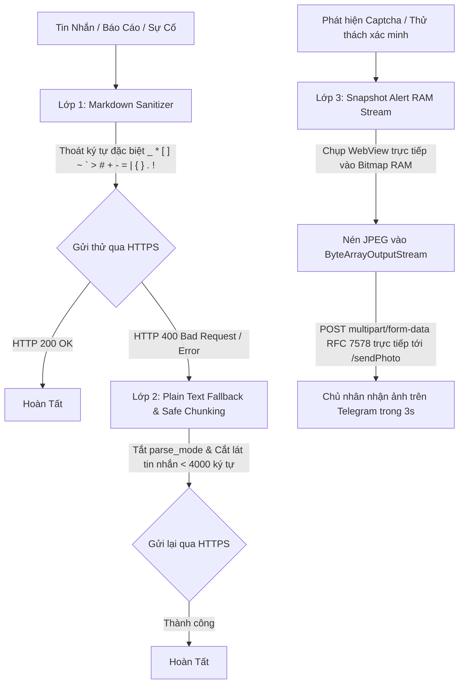
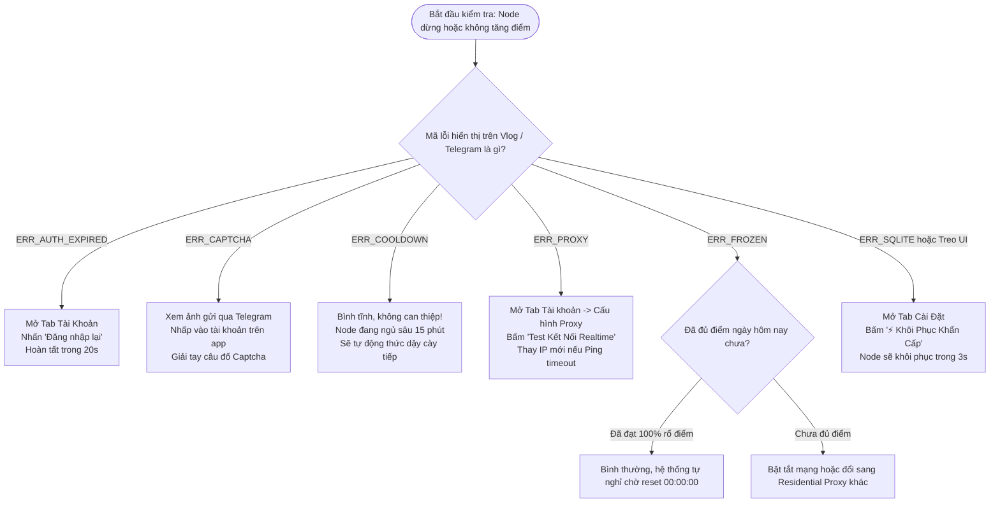
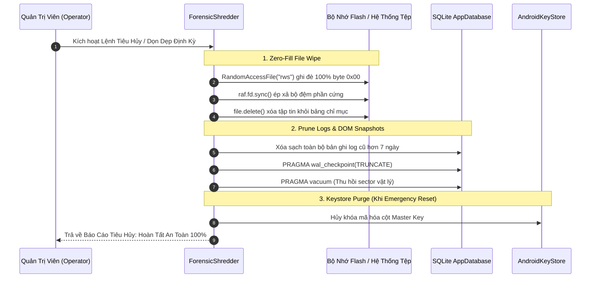

# 📕 Sổ Tay Vận Hành & Khắc Phục Sự Cố RewardsNode (Operations Runbook)

> **Hệ Thống:** RewardsNode — Autonomous Microsoft Rewards Engine for Android  
> **Môi Trường Vận Hành:** Android 8.0 – 14+ (Chuyên dụng cho Xiaomi Mi 14 HyperOS, Samsung Galaxy OneUI, OPPO/Realme ColorOS)  
> **Địa Chỉ IP Trạm Cố Định:** `192.168.1.113` (`192.168.1.113:5555`)  
> **Tiêu Chuẩn Giám Sát:** Zero-Leak WakeLock • Telemetry 3 Lớp Telegram • Tiêu Hủy Pháp Y Chuẩn Quân Sự  

---

## 📑 Mục Lục
1. [Cài Đặt & Điều Khiển Thiết Bị Qua ADB IP Tĩnh (192.168.1.113)](#1-cài-đặt--điều-khiển-thiết-bị-qua-adb-ip-tĩnh-1921681113)
2. [Cấu Hình Chạy Nền Bất Tử (Anti-Kill Guide Trên OneUI / HyperOS / ColorOS)](#2-cấu-hình-chạy-nền-bất-tử-anti-kill-guide-trên-oneui--hyperos--coloros)
3. [Thiết Lập Viễn Trắc Telegram Bot Telemetry 3 Lớp](#3-thiết-lập-viễn-trắc-telegram-bot-telemetry-3-lớp)
4. [Bảng Tra Cứu Mã Lỗi & Cây Quyết Định Xử Lý Sự Cố 30 Giây](#4-bảng-tra-cứu-mã-lỗi--cây-quyết-định-xử-lý-sự-cố-30-giây)
5. [Quy Trình Sao Lưu Encrypted Vault (.rbkp) & Tiêu Hủy An Toàn (Forensic Shredding)](#5-quy-trình-sao-lưu-encrypted-vault-rbkp--tiêu-hủy-an-toàn-forensic-shredding)

---

## 1. Cài Đặt & Điều Khiển Thiết Bị Qua ADB IP Tĩnh (192.168.1.113)

Điện thoại trạm của hệ thống được cố định tại địa chỉ IP tĩnh **`192.168.1.113`** qua cổng ADB không dây tiêu chuẩn **`5555`**.

### 1.1 Khởi Động & Kết Nối ADB Không Dây
Đảm bảo thiết bị Android đã bật **Tùy chọn cho nhà phát triển** (Developer Options) và kích hoạt **Gỡ lỗi không dây / Gỡ lỗi USB**:
```bash
# 1. Khởi động máy chủ ADB trên máy tính
adb start-server

# 2. Kết nối tới trạm thiết bị tại IP tĩnh
adb connect 192.168.1.113:5555

# 3. Kiểm tra danh sách thiết bị (phải hiển thị '192.168.1.113:5555 device')
adb devices
```

### 1.2 Cài Đặt Gói Cập Nhật APK Siêu Tốc
```bash
# Cài đặt đè giữ nguyên dữ liệu (-r)
adb -s 192.168.1.113:5555 install -r RewardsNode.apk
```

### 1.3 Cấp Quyền Tự Động Bằng CLI (Không Cần Thao Tác Màn Hình)
Sau khi cài đặt gói APK mới, chạy ngay cụm lệnh sau để cấp toàn bộ đặc quyền chạy nền và thông báo mà không cần người dùng chạm tay vào màn hình điện thoại:
```bash
# Cấp quyền hiển thị thông báo Foreground Service (Android 13+)
adb -s 192.168.1.113:5555 shell pm grant com.agy.rewardsnode android.permission.POST_NOTIFICATIONS

# Đưa ứng dụng vào danh sách miễn trừ Doze Mode (Battery Optimization Whitelist)
adb -s 192.168.1.113:5555 shell dumpsys deviceidle whitelist +com.agy.rewardsnode

# Cho phép chạy nền tuyệt đối không bị hệ thống đóng băng (AppOps Unrestricted)
adb -s 192.168.1.113:5555 shell appops set com.agy.rewardsnode RUN_IN_BACKGROUND allow
adb -s 192.168.1.113:5555 shell appops set com.agy.rewardsnode RUN_ANY_IN_BACKGROUND allow
```

### 1.4 Khởi Chạy Và Giám Sát Tiến Trình Bằng Python Script Tích Hợp
Dự án có sẵn script chuyên dụng `scripts/install_adb.py` để tự động hóa toàn bộ chu trình kiểm tra kết nối, cài đặt, cấp quyền, kiểm tra crash log và xuất dữ liệu SQLite:
```bash
# Cài đặt APK + Khởi chạy Node + Kiểm tra Crash Log:
python scripts/install_adb.py

# Chỉ kiểm tra trạng thái hoạt động & sao lưu DB (không cài lại app):
python scripts/install_adb.py --verify-only
```

---

## 2. Cấu Hình Chạy Nền Bất Tử (Anti-Kill Guide Trên OneUI / HyperOS / ColorOS)

Các nhà sản xuất Android (OEM) tích hợp cơ chế quản lý năng lượng hung hăng (Aggressive Task Killer) như MIUI Powerkeeper, Samsung Sleeping Apps hay ColorOS Quick Freeze, có thể ngắt ngầm các Foreground Service chạy lâu. 

Dưới đây là bảng thiết lập bắt buộc cho từng hệ điều hành:

### 2.1 Xiaomi / HyperOS / MIUI (Thiết Bị Điển Hình: Xiaomi Mi 14)
1. **Tiết kiệm pin ứng dụng (Battery Saver):**  
   Vào *Cài đặt* $\rightarrow$ *Ứng dụng* $\rightarrow$ *Quản lý ứng dụng* $\rightarrow$ *RewardsNode* $\rightarrow$ Nhấp vào **Tiết kiệm pin** $\rightarrow$ Chọn **"Không hạn chế" (No restrictions)**.
2. **Quyền Tự Khởi Chạy (Autostart):**  
   Trong thông tin ứng dụng RewardsNode $\rightarrow$ Bật mục **Tự khởi chạy (Autostart)** $\rightarrow$ Cho phép cả *Khởi chạy dưới nền* và *Khởi chạy bởi ứng dụng khác*.
3. **Khóa Ứng Dụng Trong Danh Sách Đa Nhiệm (Lock in Recents):**  
   Vuốt mở màn hình Đa nhiệm (Recent Apps) $\rightarrow$ Nhấn giữ lâu vào thẻ của RewardsNode $\rightarrow$ Bấm vào biểu tượng **Chiếc Khóa (Lock)**. Khi khóa thành công, một biểu tượng ổ khóa nhỏ sẽ xuất hiện cạnh tên app.
4. **Vô hiệu hóa xóa bộ nhớ khi khóa màn hình:**  
   Vào *Cài đặt Pin* $\rightarrow$ Biểu tượng bánh răng (Cài đặt bổ sung) $\rightarrow$ Đặt **"Xóa bộ nhớ đệm khi thiết bị bị khóa"** thành **"Không bao giờ"**.

### 2.2 Samsung / OneUI (Thiết Bị Điển Hình: Galaxy S23 / S24 / Z Fold)
1. **Chế độ Pin Không Giới Hạn:**  
   Vào *Cài đặt* $\rightarrow$ *Ứng dụng* $\rightarrow$ *RewardsNode* $\rightarrow$ *Pin* $\rightarrow$ Chọn **"Không hạn chế" (Unrestricted)**.
2. **Ứng Dụng Không Bao Giờ Nghỉ (Never Sleeping Apps):**  
   Vào *Cài đặt* $\rightarrow$ *Chăm sóc pin và thiết bị* $\rightarrow$ *Pin* $\rightarrow$ *Giới hạn sử dụng dưới nền* $\rightarrow$ Chọn mục **"Ứng dụng không bao giờ nghỉ"** $\rightarrow$ Nhấn dấu `+` và thêm **RewardsNode**.
3. **Tắt tính năng tự động tạm dừng:**  
   Trong trang thông tin ứng dụng RewardsNode $\rightarrow$ Tắt tùy chọn **"Tạm dừng hoạt động ứng dụng nếu không dùng" (Pause app activity if unused)**.

### 2.3 OPPO / Realme / OnePlus (ColorOS / OxygenOS / RealmeUI)
1. **Quản lý mức sử dụng pin:**  
   Vào *Cài đặt* $\rightarrow$ *Ứng dụng* $\rightarrow$ *RewardsNode* $\rightarrow$ *Mức sử dụng pin của ứng dụng* $\rightarrow$ Bật đồng thời **"Cho phép hoạt động dưới nền"** và **"Cho phép tự khởi chạy"**.
2. **Tối ưu hóa Pin:**  
   Vào *Cài đặt Pin* $\rightarrow$ *Cài đặt nâng cao* $\rightarrow$ *Tối ưu hóa việc sử dụng pin* $\rightarrow$ Tìm RewardsNode và chuyển thành **"Không tối ưu hóa" (Don't optimize)**.
3. **Khóa tác vụ gần đây:**  
   Mở màn hình đa nhiệm $\rightarrow$ Nhấn vào menu ba chấm trên đầu thẻ RewardsNode $\rightarrow$ Chọn **"Khóa" (Lock)**.

### 2.4 Cơ Chế Zero-WakeLock Cooldown Của RewardsNode
Khác với các ứng dụng thông thường liên tục giữ cờ `PARTIAL_WAKE_LOCK` khiến hệ điều hành cảnh báo "Ứng dụng gây hao pin" và ra lệnh kill tiến trình:
- Khi đang cày điểm: `WakeLockHelper` chỉ giữ cờ trong thời gian tải trang với timeout bảo vệ tối đa 60 giây.
- Khi rơi vào chu kỳ nghỉ Cooldown 15 phút: Hệ thống **chủ động giải phóng hoàn toàn WakeLock**, giải phóng WebView khỏi RAM, đăng ký còi báo thức `AlarmManager.setExactAndAllowWhileIdle()` và đưa CPU vào trạng thái **Deep Sleep**. Thiết bị tiêu thụ $< 0.05\%$ pin trong suốt thời gian chờ và tuyệt đối không bị OEM Task Killer nhắm tới.

---

## 3. Thiết Lập Viễn Trắc Telegram Bot Telemetry 3 Lớp

Hệ thống viễn trắc (Telemetry) của RewardsNode cho phép quản trị viên theo dõi trạng thái tích điểm từ xa theo thời gian thực mà không cần mở điện thoại.

### 3.1 Khởi Tạo Telegram Bot & Nhận Định Danh
1. **Tạo Bot:** Mở Telegram, tìm kiếm [@BotFather](https://t.me/BotFather) $\rightarrow$ Gửi lệnh `/newbot` $\rightarrow$ Đặt tên hiển thị và username kết thúc bằng `bot`. Nhận chuỗi **Bot Token** (Ví dụ: `7123456789:AAHk...`).
2. **Lấy Chat ID:** Tìm kiếm bot [@userinfobot](https://t.me/userinfobot) $\rightarrow$ Gửi tin nhắn bất kỳ $\rightarrow$ Nhận số **Id** người dùng của bạn (Ví dụ: `123456789`).
3. **Cấu hình trên App:** Mở RewardsNode $\rightarrow$ Tab **Cài Đặt** $\rightarrow$ Dán Token và Chat ID $\rightarrow$ Nhấn nút **"Gửi tin thử"** $\rightarrow$ Nhấn **"Lưu Cấu Hình Cài Đặt"**.

### 3.2 Cơ Chế Bảo Vệ 3 Lớp Của `TelegramNotifier`



1. **Lớp 1 — Markdown Sanitizer (`escapeMarkdown`):**  
   Tự động phát hiện và thoát toàn bộ ký tự định dạng Markdown dễ gây lỗi cú pháp (đặc biệt là địa chỉ email chứa dấu gạch dưới `user_name@domain.com` hoặc tên lỗi chứa dấu ngoặc vuông `[ERROR]`), triệt tiêu 100% lỗi `HTTP 400 Bad Request`.
2. **Lớp 2 — Plain Text Fallback & Safe Chunking:**  
   Nếu Telegram vẫn từ chối định dạng bản tin, bộ chuyển tiếp tự động hủy tham số `parse_mode` và gửi lại nội dung dưới dạng thuần văn bản (Plain Text). Đối với các báo cáo tổng kết ngày có nhiều tài khoản vượt quá giới hạn 4.096 ký tự của Telegram, thuật toán tự động chia nhỏ thành các gói tin $< 4.000$ ký tự và gửi lần lượt cách nhau 500ms.
3. **Lớp 3 — Snapshot Alert RAM Stream (Bảo Mật Cấp Doanh Nghiệp):**  
   Khi tài khoản gặp thử thách xác minh danh tính hoặc FunCaptcha, WebView tự động vẽ toàn bộ khung hình giao diện vào một đối tượng đồ họa `Bitmap` trong bộ nhớ RAM, nén ảnh sang mảng byte và gửi trực tiếp tới Telegram endpoint `/sendPhoto` qua giao thức `multipart/form-data`. **Tuyệt đối không ghi file ảnh ra đĩa flash**, ngăn ngừa hoàn toàn nguy cơ rò rỉ dữ liệu hoặc để lại dấu vết pháp y.

---

## 4. Bảng Tra Cứu Mã Lỗi & Cây Quyết Định Xử Lý Sự Cố 30 Giây

### 4.1 Bảng Tra Cứu Mã Lỗi Chuẩn Hóa

| Mã Lỗi | Tên Sự Cố & Triệu Chứng | Nguyên Nhân Gốc Rễ Kỹ Thuật | Hành Động Tự Động Của Node | Biện Pháp Can Thiệp Của Quản Trị Viên (Operator Action) |
| :---: | :--- | :--- | :--- | :--- |
| `ERR_AUTH_EXPIRED` | **Mất Phiên Đăng Nhập**<br>Log báo `401 Unauthorized` hoặc xuất hiện trang đăng nhập Microsoft Live. | Cookie xác thực `_U` hoặc `__Host-MSAAUTH` bị thu hồi bởi server Microsoft hoặc hết hạn session. | Đánh dấu tài khoản tạm dừng, chuyển sang tài khoản kế tiếp, gửi cảnh báo về Telegram. | Mở tab **Tài Khoản** $\rightarrow$ Chọn nick bị lỗi $\rightarrow$ Nhấp vào **"Đăng nhập lại"** qua WebView bảo mật. |
| `ERR_CAPTCHA` | **Vướng Thử Thách Bot**<br>Phát hiện trang Arkose Labs, FunCaptcha hoặc Cloudflare Challenge. | IP bị nghi ngờ bot hoặc tốc độ tìm kiếm vượt ngưỡng cho phép của Microsoft Anomaly Detection. | Lập tức dừng cày nick đó, chụp ảnh màn hình gửi Telegram, kích hoạt còi báo động. | Kiểm tra ảnh chụp trên Telegram. Mở app RewardsNode $\rightarrow$ Nhấp vào nick để mở WebView tự tay giải Captcha 1 lần. |
| `ERR_COOLDOWN` | **Dính Cờ Hạn Chế 15 Phút**<br>Điểm số không tăng sau 3 lượt tìm kiếm liên tiếp dù HTTP trả về 200. | Thuật toán hạn chế của Microsoft: áp dụng khoảng nghỉ 15 phút sau mỗi 3-4 truy vấn tìm kiếm. | Tự động kích hoạt Closed-Loop Cooldown, nhả WakeLock, hẹn giờ `AlarmManager` ngủ sâu 920 giây. | **Không cần làm gì cả.** Hệ thống sẽ tự động thức giấc sau 15 phút và cày tiếp hoàn toàn tự động. |
| `ERR_PROXY` | **Lỗi Cầu Nối Proxy**<br>Log báo `LoopbackProxyBridge timeout` hoặc `Connection refused`. | Residential Proxy upstream bị chết, rớt kết nối mạng hoặc sai thông tin User/Password. | Kích hoạt Circuit Breaker, tự ngắt kết nối an toàn, **tuyệt đối không dùng IP thật** để tiếp tục. | Kiểm tra lại Proxy trong tab Tài khoản. Bấm "Test Realtime" để kiểm tra IP phản hồi và độ trễ ping. |
| `ERR_FROZEN` | **Đóng Băng Điểm Số**<br>Tìm kiếm thành công 3 batch liên tiếp nhưng số dư $(\Delta\text{Points})$ vẫn bằng 0. | Microsoft đã đạt trần điểm hôm nay hoặc tài khoản bị cờ đỏ tạm thời (Shadowban). | Đóng rổ điểm tương ứng của tài khoản đó hôm nay, ghi nhận trạng thái EXHAUSTED vào DB. | Kiểm tra xem tài khoản đã đạt max điểm trong ngày chưa. Nếu chưa, để tài khoản nghỉ ngơi 24 giờ. |
| `ERR_SQLITE` | **Lỗi Khóa Cơ Sở Dữ Liệu**<br>Log báo `SQLiteDatabaseLockedException` hoặc lỗi I/O file DB. | Xung đột ghi đồng thời hoặc file WAL bị đầy sau nhiều chu kỳ hoạt động dài. | Tự động thử lại với Exponential Backoff (3 lần), kích hoạt phục hồi an toàn. | Mở tab **Cài Đặt** $\rightarrow$ Bấm nút **"⚡ Khôi Phục Khẩn Cấp (1-Tap Reset)"** để giải phóng khóa và truncate WAL. |

---

### 4.2 Cây Quyết Định Xử Lý Sự Cố Trong 30 Giây (30-Second Triage Tree)

Dành cho Operator cần chẩn đoán và khắc phục nhanh sự cố trên trạm cày điểm:



---

## 5. Quy Trình Sao Lưu Encrypted Vault (.rbkp) & Tiêu Hủy An Toàn (Forensic Shredding)

### 5.1 Cấu Trúc & Cơ Chế Tập Tin Sao Lưu Mã Hóa Quân Sự (`.rbkp`)
RewardsNode sử dụng định dạng tập tin lưu trữ mã hóa độc quyền `.rbkp` để sao lưu toàn bộ danh sách tài khoản, proxy và cookie phiên làm việc:
- **Dẫn xuất khóa (Key Derivation):** `PBKDF2WithHmacSHA256` với **100.000 vòng lặp** và chuỗi Salt ngẫu nhiên bảo mật 16 bytes.
- **Mã hóa dữ liệu (Payload Cipher):** Thuật toán `AES-256-GCM` (Galois/Counter Mode) đảm bảo đồng thời tính **bí mật** và tính **toàn vẹn dữ liệu** (Authentication Tag 128-bit).
- **Cấu trúc nhị phân tập tin:**
  ```text
  +------------------+---------------+--------------------+-----------------+------------------+---------------+----------------+----------------------+
  | Magic (4B)       | Version (1B)  | Iterations (4B)    | SaltLen (1B)    | Salt (16B)       | IvLen (1B)    | IV (12B)       | Ciphertext + Tag     |
  | 0x52 42 4B 50    | 0x01          | 0x00 01 86 A0      | 0x10            | [SecureRandom]   | 0x0C          | [SecureRandom] | [AES-256-GCM Stream] |
  +------------------+---------------+--------------------+-----------------+------------------+---------------+----------------+----------------------+
  ```

#### Quy Trình Xuất Sao Lưu (Export Backup):
1. Mở tab **Cài Đặt** trong ứng dụng RewardsNode.
2. Cuộn xuống phần **"Sao Lưu & Phục Hồi Hồ Sơ (Encrypted Vault)"**.
3. Nhập mật khẩu bảo vệ mạnh (tối thiểu 6 ký tự) $\rightarrow$ Nhấn **"Xuất File Sao Lưu (.rbkp)"**.
4. File sao lưu sẽ được xuất ra bộ nhớ máy kèm dấu thời gian: `RewardsNode_YYYYMMDD_HHmmss.rbkp`.

#### Quy Trình Phục Hồi Dữ Liệu (Import Restore):
1. Cài đặt RewardsNode trên thiết bị Android mới.
2. Mở tab **Cài Đặt** $\rightarrow$ Chọn mục **"Phục Hồi Từ File .rbkp"**.
3. Chọn tệp sao lưu từ bộ nhớ và nhập chính xác mật khẩu đã tạo.
4. Toàn bộ danh sách tài khoản, cấu hình Proxy và phiên đăng nhập sẽ được giải mã trực tiếp vào SQLite WAL mà không cần đăng nhập lại từ đầu.

---

### 5.2 Tiêu Hủy An Toàn Chuẩn Pháp Y (Forensic Shredding Engine)

Trong trường hợp cần chuyển nhượng thiết bị, kiểm tra bảo mật đột xuất hoặc thanh lý node cày điểm, công cụ `ForensicShredder.kt` cung cấp giải pháp tiêu hủy dữ liệu số mức độ sâu (Zero-Trace Forensic Sanitization):



1. **Ghi Đè Byte 0x00 Trước Khi Xóa (Zero-Fill Multi-Pass):**  
   Mọi tệp nhạy cảm (DOM Snapshot chứa HTML trang Rewards, tệp sao lưu cũ) không bao giờ bị xóa bằng hàm `delete()` thông thường của hệ điều hành. `ForensicShredder` mở tệp bằng `RandomAccessFile(file, "rws")`, ghi đè toàn bộ độ dài tệp bằng các mảng byte `0x00` và gọi `fd.sync()` để ép bộ nhớ NAND Flash ghi đè sector vật lý trước khi giải phóng chỉ mục.
2. **Dọn Dẹp Bản Ghi Lịch Sử Quá 7 Ngày (Log Pruning):**  
   Tự động quét bảng `vlog_entries`, xóa toàn bộ dữ liệu nhật ký quá 7 ngày để ngăn ngừa việc truy vết lịch sử hoạt động.
3. **Thu Hồi Dung Lượng NAND & Cắt Bỏ WAL (Reclaim & VACUUM):**  
   Thực thi câu lệnh SQL đặc biệt:
   ```sql
   PRAGMA wal_checkpoint(TRUNCATE);
   VACUUM;
   ```
   Lệnh này cắt giảm dung lượng file `rewards_node_database.db-wal` về 0 byte và tái sắp xếp lại file database chính, giải phóng triệt để dung lượng bộ nhớ trong.

### 5.3 Thao Tác Khẩn Cấp 1-Chạm (1-Tap Emergency Reset)
Khi cần đưa node về trạng thái ban đầu sạch sẽ tức thì:
- Vào **Cài Đặt** $\rightarrow$ Bấm nút màu đỏ **"⚡ Khôi Phục Khẩn Cấp (1-Tap Reset)"**.
- Hệ thống sẽ:
  - Ngắt và dừng vĩnh viễn tiến trình Foreground Service.
  - Xóa sạch toàn bộ Cache, WebStorage, IndexedDB và Cookie trong WebView.
  - Ngắt và đóng Socket của `LoopbackProxyBridge`.
  - Khôi phục trạng thái máy về `IDLE` mà vẫn bảo toàn an toàn danh sách tài khoản đã mã hóa.
