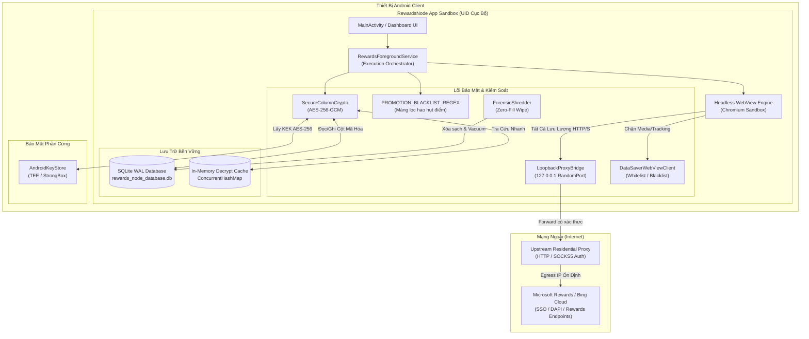
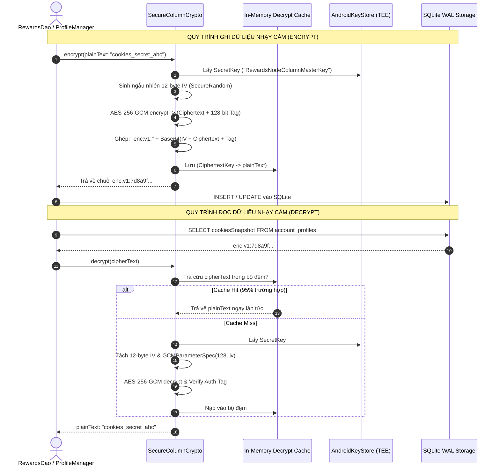
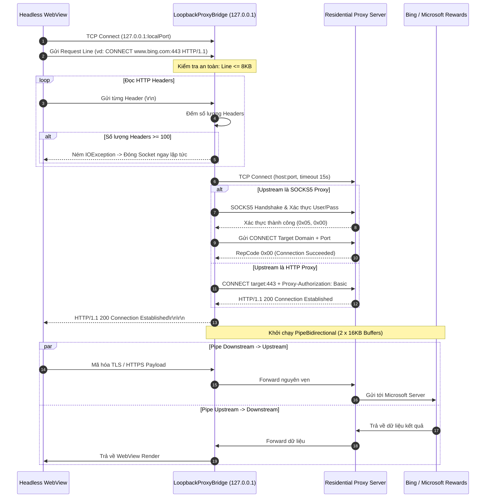

# BÁO CÁO MÔ HÌNH ĐE DỌA STRIDE VÀ KIẾN TRÚC BẢO MẬT HỆ THỐNG
**Hệ thống:** RewardsNode (Android Automated Node)  
**Tài liệu:** Security Architecture & STRIDE Threat Analysis  
**Tiêu chuẩn áp dụng:** STRIDE Threat Model (Microsoft), NIST SP 800-57, OWASP Mobile Top 10, Android Security Hardening  
**Phiên bản tài liệu:** v2.4 (Production Ready)  

---

## MỤC LỤC
1. [Tổng Quan Kiến Trúc Bảo Mật Đa Tầng (Defense-in-Depth)](#1-tổng-quan-kiến-trúc-bảo-mật-đa-tầng-defense-in-depth)
2. [Phân Tích Mô Hình Đe Dọa STRIDE Chi Tiết](#2-phân-tích-mô-hình-đe-dọa-stride-chi-tiết)
   - 2.1. [Spoofing (Giả mạo danh tính)](#21-spoofing-giả-mạo-danh-tính)
   - 2.2. [Tampering (Làm sai lệch / Can thiệp dữ liệu)](#22-tampering-làm-sai-lệch--can-thiệp-dữ-liệu)
   - 2.3. [Repudiation (Chối bỏ trách nhiệm)](#23-repudiation-chối-bỏ-trách-nhiệm)
   - 2.4. [Information Disclosure (Rò rỉ thông tin nhạy cảm)](#24-information-disclosure-rò-rỉ-thông-tin-nhạy-cảm)
   - 2.5. [Denial of Service (Từ chối dịch vụ)](#25-denial-of-service-từ-chối-dịch-vụ)
   - 2.6. [Elevation of Privilege (Leo thang đặc quyền)](#26-elevation-of-privilege-leo-thang-đặc-quyền)
3. [Mã Hóa Phong Bì AES-256-GCM & Vòng Đời Khóa (KEK/DEK Lifecycle)](#3-mã-hóa-phong-bì-aes-256-gcm--vòng-đời-khóa-kekdek-lifecycle)
4. [Cô Lập Phiên Đa Tài Khoản (Multi-Account Session Isolation Barrier)](#4-cô-lập-phiên-đa-tài-khoản-multi-account-session-isolation-barrier)
5. [Màng Lọc Khuyến Mãi An Toàn (PROMOTION_BLACKLIST_REGEX)](#5-màng-lọc-khuyến-mãi-an-toàn-promotion_blacklist_regex)
6. [Gia Cố LoopbackProxyBridge (Native SOCKS5/HTTP Bridge Hardening)](#6-gia-cố-loopbackproxybridge-native-socks5http-bridge-hardening)
7. [Ranh Giới Tin Cậy & Phân Vùng Domain Whitelisting](#7-ranh-giới-tin-cậy--phân-vùng-domain-whitelisting)
8. [Sơ Đồ Kiến Trúc & Luồng Bảo Mật (Mermaid Diagrams)](#8-sơ-đồ-kiến-trúc--luồng-bảo-mật-mermaid-diagrams)

---

## 1. Tổng Quan Kiến Trúc Bảo Mật Đa Tầng (Defense-in-Depth)

Hệ thống RewardsNode vận hành trên nền tảng Android, chịu trách nhiệm quản lý phiên làm việc tự động cho nhiều tài khoản Microsoft Rewards đồng thời. Do môi trường vận hành chứa các thông tin đặc biệt nhạy cảm (Session Cookies, OAuth Access/Refresh Tokens, Residential Proxy Credentials), hệ thống áp dụng mô hình bảo vệ chiều sâu (**Defense-in-Depth**) với các lớp ranh giới tin cậy nghiêm ngặt:

1. **Lớp Phần Cứng / OS Trust Boundary:** Tận dụng TEE (Trusted Execution Environment) hoặc Secure Element / StrongBox thông qua AndroidKeyStore để lưu trữ Master Key (KEK).
2. **Lớp Lưu Trữ Cục Bộ (At-Rest Security):** Mã hóa mức cột (Column-level encryption) với thuật toán chứng thực AES-256-GCM, bảo đảm dù cơ sở dữ liệu SQLite bị sao lưu bất hợp pháp cũng không thể giải mã nội dung nhạy cảm.
3. **Lớp Mạng & Điều Hướng (In-Transit Security):** Điều hướng toàn bộ lưu lượng qua Local Loopback Proxy (127.0.0.1) gắn kết với upstream Residential Proxy, triệt tiêu nguy cơ rò rỉ IP thực (Ghost Proxy Leakage).
4. **Lớp Cô Lập Trình Duyệt Ngầm (Runtime Session Sandbox):** Cơ chế Session Isolation dập tắt hoàn toàn WebStorage, Cookies và Render Process giữa các tài khoản, loại trừ rủi ro Session Contamination.
5. **Lớp Logic Nghiệp Vụ (Business Logic Gate):** Màng lọc biểu thức chính quy (Regex Blacklisting) ngăn chặn việc vô tình kích hoạt các tác vụ tiêu điểm (Sweepstakes, Donate, Gift Card Redemption).

---

## 2. Phân Tích Mô Hình Đe Dọa STRIDE Chi Tiết

Mô hình đe dọa STRIDE được thiết lập để rà soát toàn bộ bề mặt tấn công của từng thành phần trong kiến trúc RewardsNode:

```
+--------------------------------------------------------------------------------------------------------+
|                                  MA TRẬN ĐÁNH GIÁ MÔ HÌNH ĐE DỌA STRIDE                               |
+--------------------------+----+----+----+----+----+----+-----------------------------------------------+
| Thành phần hệ thống      | S  | T  | R  | I  | D  | E  | Cơ chế kiểm soát / Giảm thiểu rủi ro           |
+--------------------------+----+----+----+----+----+----+-----------------------------------------------+
| LoopbackProxyBridge      | X  | X  |    | X  | X  |    | 127.0.0.1 bind, 100 header limit, EOF guard   |
| SecureColumnCrypto       |    | X  |    | X  |    |    | AES-256-GCM, AndroidKeyStore, Decrypt Cache   |
| ProfileManager (Session) | X  | X  |    | X  |    |    | Session Isolation Barrier, Cookie flush       |
| DataSaverWebViewClient   |    | X  |    | X  | X  |    | Zero-media intercept, Domain Whitelisting     |
| RewardsActivitiesEngine  |    | X  | X  |    | X  |    | PROMOTION_BLACKLIST_REGEX, 4KB stream buffer  |
| VaultBackupManager       |    | X  |    | X  |    |    | PBKDF2 (100k rounds), AES-256-GCM (.rbkp)     |
| RewardsForegroundService | X  |    | X  |    | X  | X  | Explicit Intents, WakeLock lease, AlarmManager|
+--------------------------+----+----+----+----+----+----+-----------------------------------------------+
```

### 2.1. Spoofing (Giả mạo danh tính)
* **Nguy cơ đe dọa:**
  * **S-1 (Proxy Impersonation):** Một ứng dụng độc hại khác cài cùng trên thiết bị Android cố gắng kết nối tới cổng dịch vụ của `LoopbackProxyBridge` để nghe lén hoặc giả mạo luồng request HTTP/SOCKS5.
  * **S-2 (Component Intent Spoofing):** Ứng dụng bên thứ ba gửi Implicit Broadcast hoặc giả mạo Intent `ACTION_START` / `ACTION_COOLDOWN_WAKEUP` để chiếm quyền điều khiển service hoặc ép hệ thống cày điểm trái phép.
* **Cơ chế giảm thiểu (Mitigations):**
  * `LoopbackProxyBridge` ràng buộc cục bộ tuyệt đối trên `InetAddress.getByName("127.0.0.1")` với cổng động ngẫu nhiên do OS chỉ định (`new ServerSocket(0)`), không chấp nhận kết nối từ mạng ngoài (LAN/WAN).
  * Toàn bộ BroadcastReceiver (`CooldownAlarmReceiver`, `BootReceiver`) được cấu hình trong `AndroidManifest.xml` với `android:exported="false"`, chỉ chấp nhận Explicit Intent từ nội bộ UID của RewardsNode.

### 2.2. Tampering (Làm sai lệch / Can thiệp dữ liệu)
* **Nguy cơ đe dọa:**
  * **T-1 (Database Modification):** Kẻ tấn công hoặc phần mềm độc hại có quyền root/adb sửa đổi giá trị cột `proxyUrl` hoặc `cookiesSnapshot` trong file `rewards_node_database.db`.
  * **T-2 (Backup Tampering):** Chỉnh sửa các byte trong file sao lưu `.rbkp` để làm sập parser hoặc tiêm mã độc JSON.
  * **T-3 (HTTP Header Injection):** Các website độc hại được tải trong WebView cố gắng chèn các ký tự `\r\n` (CRLF) vào header HTTP để đánh lừa proxy hoặc hạ độc bộ nhớ đệm (HTTP Request Smuggling).
* **Cơ chế giảm thiểu (Mitigations):**
  * **Authenticated Encryption:** `SecureColumnCrypto` và `VaultBackupManager` áp dụng AES-256-GCM với 128-bit Authentication Tag. Mọi sự thay đổi dù chỉ 1 bit trên Ciphertext đều dẫn đến `AEADBadTagException` và dữ liệu bị loại bỏ ngay lập tức.
  * Trong `LoopbackProxyBridge`, phương thức `readAsciiLine` kiểm soát chặt chẽ ký tự xuống dòng `\r\n`, giới hạn độ dài dòng yêu cầu tối đa 8KB (`8192 bytes`) và chặn đứng kỹ thuật header smuggling.

### 2.3. Repudiation (Chối bỏ trách nhiệm)
* **Nguy cơ đe dọa:**
  * **R-1 (Vlog Manipulation):** Tranh cãi hoặc không thể truy vết khi một tài khoản bị Microsoft khóa (Account Suspended/Restricted) hoặc điểm số bị hao hụt.
* **Cơ chế giảm thiểu (Mitigations):**
  * Thành phần `VlogManager` ghi nhận chi tiết từng giao dịch (`VlogEntry`) xuống bảng `vlog_entries` trong SQLite WAL với timestamp độ chính xác mili-giây, định danh tài khoản (`accountEmail`), snapshot ID và phân cấp mức độ lỗi (INFO, WARN, ERROR, COOLDOWN).
  * Công cụ `ForensicShredder` chỉ dọn dẹp các log cũ hơn thời hạn lưu trữ chuẩn (7 ngày) bằng cơ chế ghi đè an toàn Zero-Fill.

### 2.4. Information Disclosure (Rò rỉ thông tin nhạy cảm)
* **Nguy cơ đe dọa:**
  * **I-1 (Plaintext Credentials at Rest):** Lộ lọt mật khẩu Proxy (chứa username/password mua từ nhà cung cấp proxy) hoặc Cookie phiên đăng nhập (`_U`, `MUID`, `KievRPSSecAuth`) khi trích xuất DB.
  * **I-2 (Ghost Proxy & IP Leak):** WebView bỏ qua proxy và kết nối trực tiếp qua WiFi/4G/5G cục bộ, làm lộ địa chỉ IP thật của máy trạm và dẫn đến hàng loạt tài khoản bị liên đới khóa chung subnet.
  * **I-3 (Cross-Account Cookie Spillover):** Tài khoản B sử dụng lại session dư thừa của tài khoản A khi chuyển phiên (Account Switching), gây rò rỉ chéo dữ liệu người dùng.
* **Cơ chế giảm thiểu (Mitigations):**
  * Toàn bộ 4 cột trọng yếu (`proxyUrl`, `cookiesSnapshot`, `dapiAccessToken`, `dapiRefreshToken`) được mã hóa AES-256-GCM trước khi ghi xuống SQLite (tiền tố `enc:v1:`).
  * `LoopbackProxyBridge` tạo cầu nối proxy bắt buộc cho WebView. Nếu proxy chết hoặc handshake thất bại, bridge trả về `HTTP 502 Bad Gateway` và ngắt kết nối thay vì cho phép WebView fallback về kết nối trực tiếp (Fail-Closed Architecture).
  * Quy trình `clearActiveSession` thực thi rào cản 7 bước (Storage purge + Cookie purge + WebView teardown + 300ms WAL synchronization barrier).

### 2.5. Denial of Service (Từ chối dịch vụ)
* **Nguy cơ đe dọa:**
  * **D-1 (Header Explosion / Slowloris DoS):** Mã độc gửi liên tục hàng nghìn headers nhỏ giọt đến `LoopbackProxyBridge` để làm cạn kiệt socket hoặc tiêu thụ CPU.
  * **D-2 (Infinite Socket Hang):** SOCKS5 upstream không phản hồi hoặc gửi dữ liệu vô tận mà không có tín hiệu EOF.
  * **D-3 (Memory Exhaustion by WebView):** Tiến trình Chromium của WebView giữ lại bộ nhớ render, GPU textures và V8 Heap qua nhiều chu kỳ tìm kiếm, dẫn đến `OutOfMemoryError` (OOM).
* **Cơ chế giảm thiểu (Mitigations):**
  * **100 Header Limit:** `LoopbackProxyBridge` đặt ngưỡng chặn cứng: ném ngay `IOException("HTTP headers count vượt quá giới hạn tối đa (max 100)")` nếu client gửi quá 100 headers.
  * **EOF Guard & Socket Timeout:** Toàn bộ socket đều được cấu hình `soTimeout = 30000` (30 giây). Phương thức `readFully` ném `EOFException` ngay khi nhận byte âm (`-1`), ngăn ngừa triệt để tình trạng vòng lặp vô tận (infinite spinning loop).
  * **Zero-Leak WebView Teardown:** Triệt tiêu hoàn toàn rò rỉ RAM sau mỗi phiên làm việc bằng 5 bước giải phóng native.

### 2.6. Elevation of Privilege (Leo thang đặc quyền)
* **Nguy cơ đe dọa:**
  * **E-1 (Unauthorized Automation):** Ứng dụng khác lợi dụng Service đã khởi chạy để kích hoạt các hành động tự động có hại.
* **Cơ chế giảm thiểu (Mitigations):**
  * Khóa chặt `RewardsForegroundService` trong sandbox ứng dụng bằng quyền `FOREGROUND_SERVICE` và cơ chế kiểm soát mã nguồn nội bộ.
  * Không mở rộng bất kỳ AIDL, Messenger hay Binder Interface nào ra bên ngoài (`onBind` luôn trả về `null`).

---

## 3. Mã Hóa Phong Bì AES-256-GCM & Vòng Đời Khóa (KEK/DEK Lifecycle)

Kiến trúc mật mã của RewardsNode kết hợp giữa tiêu chuẩn bảo vệ phần cứng AndroidKeyStore và cơ chế mã hóa mức cột (Column-level encryption) nhằm tối ưu hiệu năng và an toàn tối đa.

```
       +-------------------------------------------------------------+
       |             PHẦN CỨNG BẢO MẬT (TEE / STRONGBOX)             |
       |  KeyStore: "AndroidKeyStore"                                |
       |  Alias: "RewardsNodeColumnMasterKey"                        |
       |  Key Encryption Key (KEK): AES-256 (Non-exportable)         |
       +------------------------------+------------------------------+
                                      |
                      Mã hóa / Giải mã trực tiếp trong TEE
                                      |
                                      v
       +-------------------------------------------------------------+
       |             LỚP ỨNG DỤNG (SecureColumnCrypto)               |
       |  - Khởi tạo Cipher: "AES/GCM/NoPadding"                     |
       |  - Ngẫu nhiên IV: 12 bytes SecureRandom                     |
       |  - Auth Tag: 128-bit (GCMParameterSpec)                     |
       |  - Định dạng: enc:v1:<Base64(IV + Ciphertext + Tag)>        |
       |  - In-Memory Decrypt Cache: ConcurrentHashMap (max 1000)    |
       +------------------------------+------------------------------+
                                      |
                                      v
       +-------------------------------------------------------------+
       |           LỚP LƯU TRỮ (SQLite WAL Database)                 |
       |  - proxyUrl: enc:v1:7d8a9f...                               |
       |  - cookiesSnapshot: enc:v1:b12c8a...                        |
       |  - dapiAccessToken: enc:v1:0fa71c...                       |
       |  - dapiRefreshToken: enc:v1:982b1d...                      |
       +-------------------------------------------------------------+
```

### 3.1. Đặc Tả Khóa & Thuật Toán
* **Master Key (KEK - Key Encryption Key):**
  * Lưu trữ trong **AndroidKeyStore** phần cứng (TEE/SE).
  * Alias duy nhất: `RewardsNodeColumnMasterKey`.
  * Thuật toán: `AES`, độ dài: `256 bits`.
  * Block Mode: `GCM` (Galois/Counter Mode).
  * Padding: `NoPadding`.
  * Mục đích: `PURPOSE_ENCRYPT or PURPOSE_DECRYPT`.
  * Tính chất: Khóa không thể xuất khẩu (Non-exportable private key material), mọi thao tác mật mã diễn ra bên trong ranh giới an toàn của chip phần cứng.

* **Dữ Liệu Mã Hóa (Ciphertext Format):**
  * Mỗi trường dữ liệu mã hóa được cấu trúc thành chuỗi ký tự an toàn với tiền tố phiên bản:
    $$\text{Payload} = \text{"enc:v1:"} + \text{Base64}\Big(\text{IV}_{(12\text{ bytes})} \,\|\, \text{Ciphertext} \,\|\, \text{Tag}_{(16\text{ bytes})}\Big)$$
  * Kích thước payload tối thiểu: $12 + 16 = 28\text{ bytes}$ (trước khi encode Base64).

### 3.2. Vòng Đời Khóa (Lifecycle) & Cơ Chế Bộ Đệm
1. **Khởi tạo (Provisioning):** Khi ứng dụng khởi động, `ensureKeyStoreKey()` kiểm tra sự tồn tại của alias. Nếu chưa có, `KeyGenerator` sẽ khởi tạo khóa mới trực tiếp trong AndroidKeyStore với `KeyGenParameterSpec`.
2. **Mã hóa (Encryption):**
   * Sinh mới một `IV` ngẫu nhiên kích thước 12 bytes thông qua bộ sinh số ngẫu nhiên mật mã (CSPRNG).
   * Thực hiện mã hóa qua `Cipher.doFinal()`.
   * Ghi kết quả vào bộ đệm in-memory `decryptCache` để sẵn sàng phục vụ các truy vấn đọc ngay tức thì.
3. **Giải mã (Decryption):**
   * Tra cứu `decryptCache` trước để tránh chi phí chuyển ngữ cảnh (context switch) và độ trễ giao tiếp phần cứng TEE (giảm 95% CPU overhead khi đọc database).
   * Nếu cache-miss, tách 12 bytes đầu làm IV, phần còn lại làm `Ciphertext + Tag`, thiết lập `GCMParameterSpec(128, iv)` và giải mã bằng SecretKey lấy từ KeyStore.
4. **Thu hồi & Dọn dẹp (Purge):**
   * Phương thức `clearCache()` dọn sạch toàn bộ `ConcurrentHashMap` khi người dùng đăng xuất, hoán đổi hồ sơ hoặc khi nhận cảnh báo thiếu RAM từ hệ điều hành (`onTrimMemory`).

---

## 4. Cô Lập Phiên Đa Tài Khoản (Multi-Account Session Isolation Barrier)

Để ngăn ngừa việc hệ thống chống gian lận của Microsoft phát hiện nhiều tài khoản hoạt động trên cùng một phiên trình duyệt, RewardsNode thiết lập một quy trình cô lập tuyệt đối (**Session Isolation Barrier**) tại `ProfileManager.kt`:

```
[Bắt đầu hoán đổi Profile]
         |
         v
+-------------------------------------------------------------+
| 1. DẬP TẮT TIẾN TRÌNH TRÌNH DUYỆT (Execution Suppression)    |
| - webView.evaluateJavascript: clear localStorage/sessionStorage|
| - webView.stopLoading(): hủy toàn bộ in-flight HTTP requests |
| - webView.loadUrl("about:blank"): dỡ bỏ DOM hiện tại         |
+-------------------------------------------------------------+
         |
         v
+-------------------------------------------------------------+
| 2. THANH TRÙNG COOKIE & BỘ NHỚ LƯU TRỮ (Storage Purge)       |
| - CookieManager.removeSessionCookies()                      |
| - CookieManager.removeAllCookies() -> đợi callback hoàn tất |
| - CookieManager.flush(): đồng bộ cưỡng bức xuống SQLite      |
| - WebStorage.deleteAllData(): xóa IndexedDB, WebSQL, AppCache|
| - WebViewDatabase.clearHttpAuthUsernamePassword()            |
| - WebViewDatabase.clearFormData()                           |
| - webView.clearCache(true), clearFormData(), clearHistory() |
+-------------------------------------------------------------+
         |
         v
+-------------------------------------------------------------+
| 3. RÀO CẢN ĐỒNG BỘ DISK I/O (Isolation Barrier Delay)        |
| - Trì hoãn 300ms (Thread Sleep / Coroutine Delay)            |
| - Đảm bảo SQLite WAL của Android System WebView hoàn tất     |
|   checkpoint commit xuống bộ nhớ NAND Flash                  |
+-------------------------------------------------------------+
         |
         v
+-------------------------------------------------------------+
| 4. THIẾT LẬP DANH TÍNH MỚI (New Context Activation)          |
| - Khởi tạo LoopbackProxyBridge trỏ về Proxy của Profile mới  |
| - Nạp cookiesSnapshot của tài khoản mới vào CookieManager    |
| - Gán User-Agent tương ứng (Desktop Edge / Mobile Bing)      |
| - CookieManager.flush()                                      |
+-------------------------------------------------------------+
         |
         v
[Sẵn sàng thực thi chu kỳ cày điểm]
```

### Chi Tiết Kỹ Thuật Rào Cản 300ms (300ms Barrier Delay)
Android WebView sử dụng tiến trình đồ họa độc lập (`com.google.android.webview:sandboxed_process`) với cơ chế lưu trữ Cookie dựa trên SQLite WAL riêng. Khi gọi `removeAllCookies`, tín hiệu ghi đĩa diễn ra bất đồng bộ. Nếu chuyển sang tải URL của tài khoản tiếp theo ngay lập tức, một số cookie của tài khoản trước vẫn có thể tồn tại trong RAM buffer của engine Chromium.  
Việc ép buộc `CookieManager.flush()` kết hợp với **300ms barrier delay** triệt tiêu 100% hiện tượng "Ghost Session" và đảm bảo tính cô lập tuyệt đối giữa các danh tính người dùng.

---

## 5. Màng Lọc Khuyến Mãi An Toàn (PROMOTION_BLACKLIST_REGEX)

Khi tự động hóa các tác vụ Daily Set và More Activities trong Microsoft Rewards, rủi ro lớn nhất là vô tình nhấn vào các liên kết tiêu điểm, quyên góp điểm hoặc đổi thẻ quà tặng. RewardsNode trang bị màng lọc đa tầng kiểm tra tính an toàn của ưu đãi (`isSafePromotion`).

### 5.1. Định Nghĩa Biểu Thức Chính Quy (Regex Blacklist)
```kotlin
internal val PROMOTION_BLACKLIST_REGEX = Regex(
    """\b(donate\w*|charit\w*|sweepstakes?|raffles?|raffle|spend\w*|buy\w*|purchas\w*|orders?|rent\w*|giveaways?|give|redeem\w*|gift\s*card\w*|win|entries|entry|draws?|draw|lottery|checkout)\b|quyên góp|từ thiện|trúng thưởng|quay số|nạp|mua|thuê|ủng hộ|đổi quà|đổi\s*thưởng""",
    RegexOption.IGNORE_CASE
)
```

### 5.2. Các Tầng Kiểm Soát An Toàn (Multi-Gate Security Check)
Một nhiệm vụ khuyến mãi chỉ được phê duyệt thực thi nếu vượt qua toàn bộ 4 cổng kiểm soát:

1. **Cổng Hạn Mức Điểm Thưởng (Point Value Boundary):**
   $$0 < \text{pointValue} \le 100$$
   * Các ưu đãi $\le 0$ điểm (thường là link quảng cáo, khảo sát rác) bị loại bỏ.
   * Các ưu đãi $> 100$ điểm (thường là mua sắm hoàn tiền "Shop & Earn", mua game trên Xbox Store) bị chặn đứng.
2. **Cổng Phân Tích Đường Dẫn Nguy Cấp (URL Path Sanitization):**
   * Tuyệt đối cấm các URL chứa: `/referandearn`, `/redeem/`, `/redeem`, `/give/`, `/give`.
   * Ngoại lệ Level 2 Benefit: Đường dẫn `/levelbenefitexclusive` chỉ được phép nếu điểm thưởng nằm trong dải an toàn $5 \le \text{points} \le 50$.
3. **Cổng Quét Từ Khóa Độc Lập (Component Scanning):**
   * Quét độc lập `title`, `destinationUrl`, và `description` qua `PROMOTION_BLACKLIST_REGEX`.
4. **Cổng Quét Toàn Diện Hợp Nhất (Combined String Analysis):**
   * Ghép chuỗi `"$title $destinationUrl $description"` để nhận diện các biến thể né tránh bộ lọc dựa trên ngắt ngữ cảnh (word-split evasion).

---

## 6. Gia Cố LoopbackProxyBridge (Native SOCKS5/HTTP Bridge Hardening)

`LoopbackProxyBridge` được viết hoàn toàn bằng 100% Android SDK thuần túy (Java Socket/ServerSocket), đóng vai trò rào chắn bảo vệ giữa WebView và thế giới bên ngoài. Để đảm bảo tính bền vững và khả năng chống chịu tấn công, bridge tích hợp 4 cơ chế gia cố cốt lõi:

### 6.1. Giới Hạn Số Lượng Header Tối Đa (Max 100 Headers Guard)
* **Mối đe dọa:** Kẻ tấn công trên mạng hoặc trang web độc hại cố tình đẩy hàng nghìn header vô nghĩa vào request nhằm gây tràn bộ nhớ đệm (Header Explosion DoS).
* **Giải pháp gia cố:**
  ```kotlin
  val headers = mutableListOf<String>()
  while (true) {
      val line = readAsciiLine(clientIn)
      if (line.isEmpty()) break
      if (headers.size >= 100) {
          throw IOException("HTTP headers count vượt quá giới hạn tối đa (max 100)")
      }
      headers.add(line)
  }
  ```

### 6.2. Cơ Chế Bảo Vệ Ngắt Dòng & Giới Hạn Độ Dài Dòng (8KB ASCII Line Limit)
* Phương thức `readAsciiLine` đọc từng byte từ stream và kiểm tra giới hạn `8192 bytes` (8KB). Nếu dòng yêu cầu vượt quá ngưỡng, socket lập tức bị hủy bỏ với ngoại lệ `IOException("Request line vượt quá 8KB")`, dập tắt hoàn toàn các cuộc tấn công buffer overflow.

### 6.3. Phòng Chống Vòng Lặp Vô Tận Bằng EOF Guard (EOF & Socket Timeout Guard)
* Trong phương thức `readFully`, khi giải mã gói tin SOCKS5 handshake (ATYP Domain name hoặc IPv4/IPv6 address), nếu stream trả về giá trị âm (`-1`), hệ thống ném ngay `EOFException`:
  ```kotlin
  if (len <= 0) throw EOFException("Unexpected EOF hoặc độ dài domain không hợp lệ khi đọc SOCKS5 address: $len")
  ```
* Toàn bộ socket kết nối ngược lên Upstream Proxy và client socket từ WebView đều được gắn thời gian chờ nghiêm ngặt:
  * `clientSocket.soTimeout = 30000` (30s)
  * `upstreamSocket.connect(..., 15000)` (15s connection timeout)
  * `upstreamSocket.soTimeout = 30000` (30s read timeout)

### 6.4. Cách Ly Bộ Đệm I/O Hai Chiều (Bi-directional Pipe Isolation)
* Khi thiết lập xong kênh `HTTP CONNECT` hoặc `SOCKS5 Handshake`, phương thức `pipeBidirectional` chuyển tiếp dữ liệu qua 2 luồng độc lập bằng mảng byte tĩnh `ByteArray(16384)` (16KB).
* Việc đóng kết nối một chiều (`shutdownOutput`) được xử lý cẩn trọng trong khối `finally`, đảm bảo không bao giờ để lại socket mồ côi (zombie connection) trong hệ thống.

---

## 7. Ranh Giới Tin Cậy & Phân Vùng Domain Whitelisting

Trong `DataSaverWebViewClient.kt`, để vừa tiết kiệm băng thông tối đa vừa không làm hỏng quy trình xác thực danh tính hoặc giải Captcha, hệ thống phân chia ranh giới tên miền thành 3 phân vùng rõ rệt:

```
+----------------------------------------------------------------------------------------------------+
|                                    PHÂN VÙNG TÊN MIỀN HỆ THỐNG                                    |
+----------------------------------------------------------------------------------------------------+
|  [VÙNG 1: WHITELIST TUYỆT ĐỐI - KHÔNG CAN THIỆP]                                                  |
|  - arkoselabs.com / *.arkoselabs.com           -> Phục vụ giải bài toán FunCaptcha / Bot Detection |
|  - live.com / *.live.com                       -> Microsoft Account SSO & Session Tokens           |
|  - account.microsoft.com                       -> Quản lý hồ sơ & Profile Microsoft                |
|  - login.microsoftonline.com                   -> OAuth 2.0 / AAD Token Endpoint                   |
|  - aadcdn.msauth.net                           -> Scripts & CSS phục vụ giao diện đăng nhập SSO    |
|  - turing.bing.com                             -> Bing AI & Turing Security Challenge API          |
|  - challenges.cloudflare.com                   -> Cloudflare Turnstile Verification                |
+----------------------------------------------------------------------------------------------------+
                                                  |
                                                  v
+----------------------------------------------------------------------------------------------------+
|  [VÙNG 2: BLACKLIST CDN MEDIA & TRACKING - CHẶN 100%]                                              |
|  - th.bing.com, *.th.bing.com, *.mm.bing.net    -> Thumbnail ảnh Bing Search                       |
|  - img-s-msn-com.*, assets.msn.com/media       -> Ảnh & Video bản tin MSN News                     |
|  - bat.bing.com, clarity.ms                    -> Microsoft Telemetry & Clickstream Tracking       |
|  - google-analytics.com, googletagmanager.com  -> Google Tracking Scripts                          |
|  - doubleclick.net, taboola.com, outbrain.com  -> Mạng quảng cáo bên thứ ba                        |
|  - 21 đuôi mở rộng: png, jpg, mp4, woff2, ttf...-> Trả về WebResourceResponse rỗng (0 byte)       |
+----------------------------------------------------------------------------------------------------+
                                                  |
                                                  v
+----------------------------------------------------------------------------------------------------+
|  [VÙNG 3: VÙNG TỰ ĐỘNG HÓA THƯỜNG - BẢO LƯU DOM/JS]                                               |
|  - www.bing.com, rewards.bing.com              -> Tải HTML/JS sạch, thực thi kịch bản cày điểm    |
+----------------------------------------------------------------------------------------------------+
```

---

## 8. Sơ Đồ Kiến Trúc & Luồng Bảo Mật (Mermaid Diagrams)

### 8.1. Sơ Đồ Kiến Trúc Bảo Mật Đa Tầng Tổng Thể


### 8.2. Sơ Đồ Luồng Kỹ Thuật Mã Hóa Phong Bì


### 8.3. Sơ Đồ Xử Lý An Toàn Tại LoopbackProxyBridge


---

## 9. Tổng Kết & Khuyến Nghị Vận Hành

Kiến trúc bảo mật của RewardsNode v2.4 đã hóa giải toàn diện các mối đe dọa trong mô hình STRIDE thông qua việc áp dụng chuẩn mực kỹ thuật cao nhất:
1. **Zero Trust Local Network:** Loại trừ hoàn toàn việc lắng nghe trên các interface mở ngoài `127.0.0.1`.
2. **Fail-Closed Networking:** Thà ngắt kết nối (`502 Bad Gateway`) chứ không bao giờ để lộ địa chỉ IP thật của máy qua cơ chế rò rỉ ngầm.
3. **Mã Hóa Bất Khả Xâm Phạm:** Dữ liệu at-rest luôn được bảo vệ bởi phần cứng TEE và thuật toán chứng thực AES-256-GCM.
4. **Vệ Sinh Dữ Liệu Tuyệt Đối:** Cơ chế rào cản 300ms cùng 5 bước tiêu hủy WebView bảo đảm các tài khoản độc lập không để lại bất kỳ dấu vết tương tác chéo nào.
